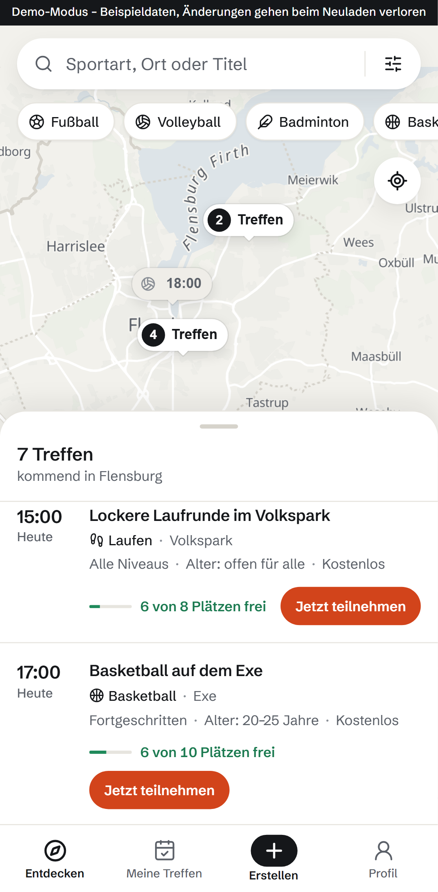
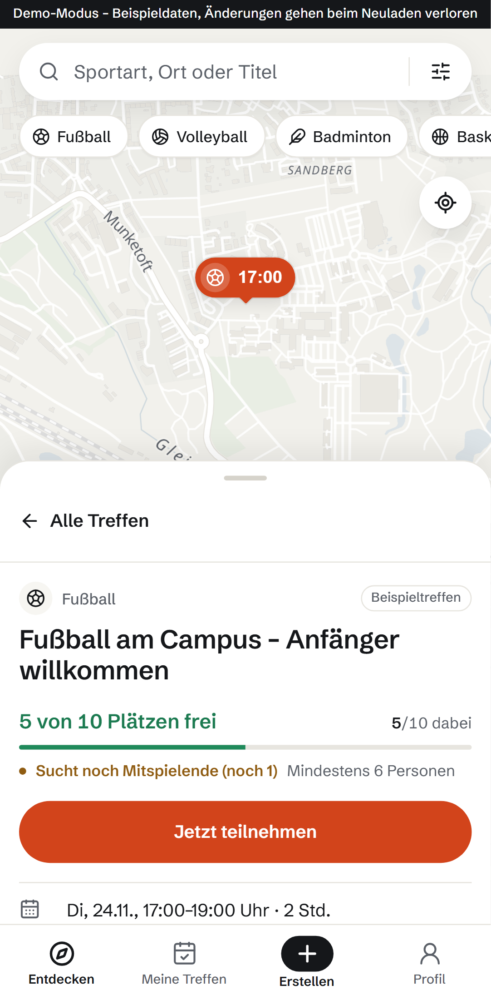
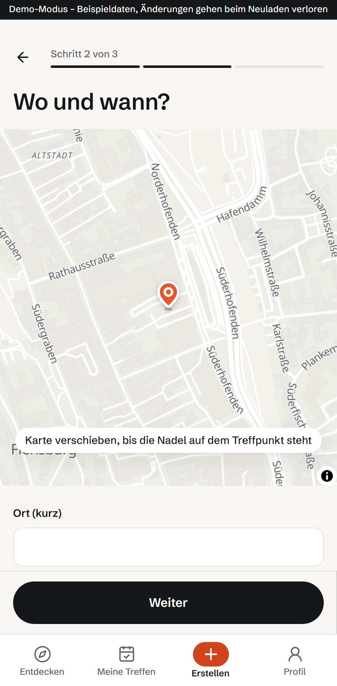
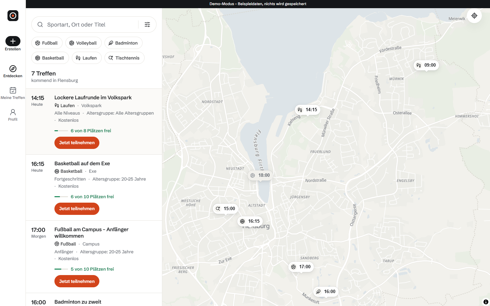
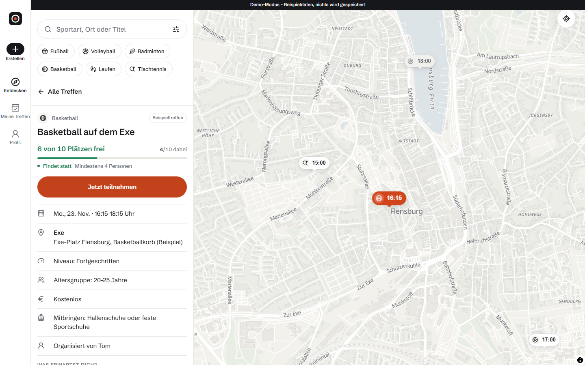

# SportMate

SportMate ist eine mobile Web-App, mit der Menschen in Flensburg spontan Sporttreffen finden und ihnen mit einem Klick
beitreten können. Jedes Treffen zeigt vorab, was man vor dem ersten Treffen mit Fremden wissen will: Niveau, Alter,
Kosten, Mitbringen, Treffpunkt, Organisator und freie Plätze. Wer Mitspielerinnen und Mitspieler sucht, stellt selbst
ein Treffen in drei Schritten ein.

Hochschul-Softwareprojekt im Wintersemester 2026/27 · Team: Julien, Renat, Paulo, Niklas.

- **Live-App:** <https://sportmate-gamma.vercel.app> (Vercel, Daten in Supabase)
- **Repository:** <https://github.com/Paulo-Temme/SportMate> (Arbeitsbranch `develop`)

## Screenshots

| Entdecken (mobil) | Detailansicht (mobil) | Treffen erstellen, Schritt 2 (mobil) |
| --- | --- | --- |
|  |  |  |

| Entdecken (Desktop) | Detailansicht (Desktop) |
| --- | --- |
|  |  |

## Funktionsumfang Release 1 (Stand 23.11.2026)

Release 1 ist der Umfang für Präsentation 5 am 25.11.2026 (`docs/backlog.md`). Stand nach dem Endlauf vom 23.11.2026:
11 von 14 Release-1-Stories umgesetzt (jedes Akzeptanzkriterium mit grünem Test), 3 teilweise – F-12 (Wortlaut von Termin und
Altersangabe weicht vom AK ab), F-13 (Kostenhinweis und reiner Text ohne Test), F-22 (kein automatischer Paralleltest auf den
letzten Platz). Tests je Kriterium: `docs/testing/testfaelle.md`.

| Bereich | Was die App kann | Stories |
| --- | --- | --- |
| Entdecken | Vollbild-Karte (MapLibre, OpenFreeMap) mit Bottom Sheet und Trefferliste; Karte und Liste zeigen dieselben Treffer; überlappende Marker werden zu Gruppen mit Anzahl, Klick fächert auf; „x von y Plätzen frei“, Ausgebuchte zuletzt; Offline-Karte als Rückfall | F-05, F-08 |
| Suchen und Filtern | Suchleiste, Sportarten-Chips, Filterdialog mit Zeitraum, Niveau und Altersgruppe, Leerzustand mit „Selbst ein Treffen erstellen“ | F-06, F-07, F-09 |
| Details | Termin mit Dauer, Treffpunkt, Niveau, eindeutige Altersangabe, Plätze, Kosten, Mitbringen, „Was erwartet dich?“, Organisator, Hinweis „Sucht Mitspieler (noch n)“; eigene Adresse je Treffen (`/treffen/<id>`), unbekannte Adresse zeigt „Treffen nicht gefunden“ | F-12, F-13, F-14, F-25 (AK1), F-15 (AK3) |
| Konto | Registrieren, Anmelden, Abmelden, Profil mit Zählern „dabei“/„organisiert“; Stöbern ohne Konto, Anmeldung erst beim Mitmachen mit Rücksprung | F-01, F-02 |
| Organisieren | Erstellen-Assistent in drei Schritten mit Ortswahl auf der Karte und Feldvalidierung; eigenes Treffen absagen | F-17, F-18 |
| Teilnahme | „Jetzt teilnehmen“, Teilnahme zurückziehen, „Meine Treffen“ mit Reitern; Überbuchungsschutz in der Datenbank | F-22, F-23, F-24 |
| Betrieb | Lokaler Demo-Modus ohne Server mit gekennzeichneten Beispieldaten; Erstbesuch-Hinweis „So funktioniert's“ | F-32, F-31 |

Bewusst nicht enthalten (siehe `docs/backlog.md`, Abschnitt Nicht-Ziele in `docs/vision.md`): Bezahlung, Hallenbuchung,
Chat, Bewertungen, Benachrichtigungen, Treffen bearbeiten, Umkreissuche.

## Tech-Stack

| Bereich | Technik |
| --- | --- |
| App | Next.js 16 (App Router), React 19, TypeScript (strict) |
| Karte | MapLibre GL JS mit Stil OpenFreeMap Positron (ohne API-Key) |
| Animation, Icons | `motion`, `lucide-react` |
| Backend | Supabase: Auth (E-Mail/Passwort), PostgreSQL mit Row Level Security, RPC-Funktionen |
| Tests | Vitest (Unit, Komponente, Integration), Testing Library, Playwright (Akzeptanz/E2E) |
| Qualität | ESLint, Prettier, GitHub Actions (CI), SE-Eval (externe Messung) |
| Hosting | Vercel |

Architektur und Begründungen: `docs/architecture.md`, Entscheidungsnotizen `docs/decisions/`.

## Lokal starten

Voraussetzungen: Git, Node.js ab Version 22, npm. Optional `make` (Windows: `winget install ezwinports.make`).

```bash
git clone https://github.com/Paulo-Temme/SportMate.git
cd SportMate
git switch develop
npm ci
npm run dev
```

Die App läuft dann unter <http://localhost:3000>.

### Demo-Modus (ohne Konfiguration)

Ohne Umgebungsvariablen startet die App im **lokalen Demo-Modus**: Beispieltreffen in Flensburg, Demo-Personen zum
Anmelden, oben der dauerhafte Hinweis „Demo-Modus – Beispieldaten, Änderungen gehen beim Neuladen verloren“. Treffen liegen nur im
Arbeitsspeicher des Browsers; Neuladen stellt den Ausgangszustand wieder her. Kein Server und kein Konto nötig.

### Supabase-Modus (mit echtem Konto)

1. Supabase-Projekt anlegen und Schema einspielen: Anleitung in `supabase/README.md`
   (erst `supabase/migrations/0001_initial_schema.sql`, dann `supabase/seed.sql`).
2. `.env.example` nach `.env.local` kopieren und die beiden Werte eintragen:
   ```
   NEXT_PUBLIC_SUPABASE_URL=<Project URL>
   NEXT_PUBLIC_SUPABASE_ANON_KEY=<anon / publishable key>
   ```
3. `npm run dev` neu starten. Sind beide Variablen gesetzt, nutzt die App Supabase, sonst den Demo-Modus.

Der `service_role`-Schlüssel wird nie benötigt und gehört nicht in die App.

## Tests ausführen

| Zweck | Befehl |
| --- | --- |
| Lint, Typprüfung, Unit-/Komponenten-/Integrationstests | `make check` (ohne make: `npm run check`) |
| Coverage (`src/lib`) | `make coverage` |
| Akzeptanztests einmalig vorbereiten | `npx playwright install chromium` |
| Akzeptanztests (Mobile Chrome und Desktop Chrome) | `npx playwright test` (oder `make e2e`) |
| Supabase-Integration gegen eine echte Datenbank | `SUPABASE_INTEGRATION=1 npx vitest run tests/integration/supabase-event-repository.int.test.ts` (Supabase-Variablen in der eigenen Shell gesetzt) |
| Nachvollziehbarkeit Akzeptanzkriterium → Test | `make trace` |

Playwright startet selbst einen Dev-Server auf Port 3010 im Demo-Modus mit Offline-Karte. Next.js 16 erlaubt nur einen
Dev-Server je Projektordner; läuft bereits `npm run dev`, diesen vorher beenden.
Die Supabase-Integrationstests werden ohne `SUPABASE_INTEGRATION=1` übersprungen und laufen nicht in der CI.

Endlauf (`docs/testing/testbericht.md`, 23.11.2026, Commit `004a9fa`): Vitest 283 bestanden / 2 übersprungen (29 Dateien),
mit echter Supabase-DB 285/285; Playwright 117 bestanden / 1 gewollt übersprungen (59 Tests × 2 Geräteprofile, 48,1 s);
`tsc` 0 Fehler, ESLint 0 Befunde; Coverage `src/lib` 90,66 % Zeilen / 85,31 % Zweige. Gefundene Fehler: 4, alle behoben.
Review: 15 Befunde, 10 behoben, 5 offen.

## Deployment

- Vercel baut das Repository als Next.js-Projekt (`npm run build`). Es gibt keine eigene Serverlogik; Vercel liefert
  nur Seiten und JavaScript aus.
- Umgebungsvariablen in Vercel (Project Settings → Environment Variables): `NEXT_PUBLIC_SUPABASE_URL`,
  `NEXT_PUBLIC_SUPABASE_ANON_KEY`. Fehlen sie, läuft auch die gehostete Version im Demo-Modus.
- In Supabase unter Authentication → URL Configuration die Vercel-Adresse als Site URL eintragen
  (`supabase/README.md`).
- Vor einer Präsentation `supabase/seed.sql` erneut ausführen, damit die Demotreffen in der Zukunft liegen.

## Projektstruktur

```
src/
  app/            Routen: Entdecken (/), treffen/[id], meine-treffen, erstellen, profil, anmelden
  components/     Oberfläche: map, sheet, discover, event, create-event, auth, my-events, navigation, profile, app
  lib/events/     Kernlogik ohne Oberfläche und I/O: Modell, Validierung, Suche, Teilnahme, Anzeige, Demodaten
  lib/auth/       Regeln für Anmeldedaten
  lib/data/       Datenzugriff: EventRepository und AuthGateway, je lokal und Supabase
  lib/map/, lib/ui/  reine Karten- und Sheet-Logik
e2e/              Playwright-Akzeptanztests
tests/            Integrationstests und Testdaten
supabase/         Migration, Seed, Anleitung
docs/             Projektdokumentation (siehe unten)
specs/            Spec, Protokoll und Review je Story
abgabe/           Entwürfe der Abgabedokumente und PDF-Erzeugung
.claude/          Agentenrollen, Befehle, Schutz-Hook
```

## Dokumentation

| Thema | Datei |
| --- | --- |
| Ziele, Hypothesen, Stakeholder, Qualitätsziele | [docs/vision.md](docs/vision.md) |
| Kundenfeedback (Register FB-01 … FB-58) und Rohmaterial | [docs/feedback.md](docs/feedback.md), [docs/feedback/roh/](docs/feedback/roh/) |
| Epics, Stories, Akzeptanzkriterien | [docs/backlog.md](docs/backlog.md) |
| Altanforderungen → Stories | [docs/requirements/traceability.md](docs/requirements/traceability.md) |
| Architektur | [docs/architecture.md](docs/architecture.md) |
| Entscheidungen (ADR 0001–0009) | [docs/decisions/](docs/decisions/) |
| Designleitlinien | [docs/design.md](docs/design.md) |
| Coding-Standards | [docs/coding-standards.md](docs/coding-standards.md) |
| Teststrategie, Testfälle, Testbericht, Fehler, Reviews | [docs/teststrategie.md](docs/teststrategie.md), [docs/testing/](docs/testing/), [docs/review-leitfaden.md](docs/review-leitfaden.md) |
| Prozess und Rollen der Agenten | [docs/prozess.md](docs/prozess.md) |
| Einstieg für neue Teammitglieder | [docs/einstieg.md](docs/einstieg.md) |
| Management (Praktiken, Probleme, Zeiterfassung) | [docs/management/](docs/management/) |
| Supabase einrichten | [supabase/README.md](supabase/README.md) |
| Abgabedokumente (Entwürfe, PDF) | [abgabe/](abgabe/) |

## Entwicklungsprozess mit KI-Agenten

Das Team entwickelt mit Claude Code in festen Rollen. Die Hauptsitzung (Orchestrator) ruft je Story nacheinander
architect, planner, tester, coder und reviewer auf; analyst wertet Feedback aus, reporter stellt Abgabedokumente
zusammen. Jede Rolle darf nur in ihrem Bereich schreiben (durchgesetzt durch `.claude/hooks/guard.mjs`). Tests werden
vor dem Code geschrieben und getrennt committet. Der Mensch gibt Vision, Feedback-Konsequenzen, Architektur, Story-Liste
und Spec frei und führt Push und Merge selbst aus. Details: [docs/prozess.md](docs/prozess.md).

## Team

| Person | Hauptverantwortung (laut Präsentation 1, 30.09.2026) |
| --- | --- |
| Julien | Anforderungen: Interviews, User Stories, Akzeptanzkriterien, Kundenfeedback |
| Renat | Architektur und Entwurf: Systemstruktur, Datenmodell, Oberflächenentwurf |
| Paulo | Implementierung: Entwicklung koordinieren, Code integrieren, Coding-Regeln |
| Niklas | Management und Qualitätssicherung: Planung, Board, Tests, Fortschritt |

Alle entwickeln und reviewen.

## Offene Punkte (ehrlich)

- Drei Release-1-Stories nur teilweise umgesetzt (F-12, F-13, F-22, siehe oben); Specs gibt es nur für F-01 und F-22,
  keine `review.md` je Story.
- Offene Review-Befunde: REV-02 (Supabase-Integrationstests nicht in der CI), REV-09 (veralteter Kommentar in der Migration),
  REV-10 (Organisator-Kennung öffentlich lesbar, Entscheidung offen), REV-13 (Zeilentypen ohne Laufzeitprüfung),
  REV-14 (Komplexitätsregel nicht im Lint).
- Mutation Score nicht verwertbar (Messfehler unter Windows), Messung unter Linux offen.
- Menschliches Review der Migration und der Anmelde-/Datenzugriffsdateien steht laut Review-Protokoll aus.
- Kein automatischer Paralleltest auf den letzten Platz; Schutz durch Zeilensperre und Check-Constraint (ADR-0006).
- Nutzertest mit fünf echten Personen (NFR-1) ist für Präsentation 6 geplant und noch nicht durchgeführt.
- Zeiterfassung (`docs/management/zeiterfassung.csv`) und Retrospektiven sind noch leer; Board-Link fehlt hier.
- Passwort-Mindestlänge (8 oder 12) und E-Mail-Bestätigung für einen echten Betrieb sind nicht entschieden.
- Datenschutzhinweis zu den Kartenkacheln (OpenFreeMap überträgt IP und Kartenausschnitt) fehlt noch in der App.
