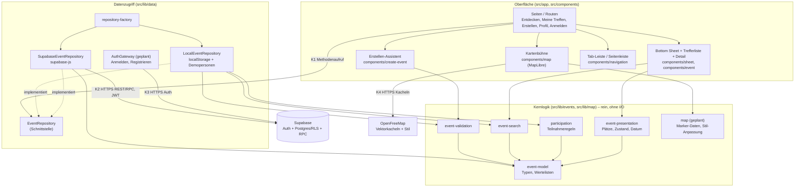
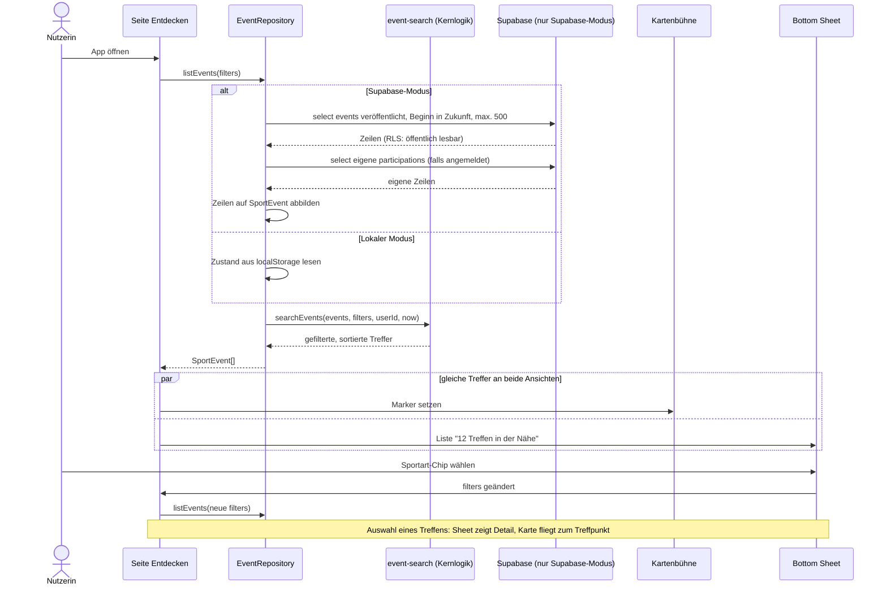
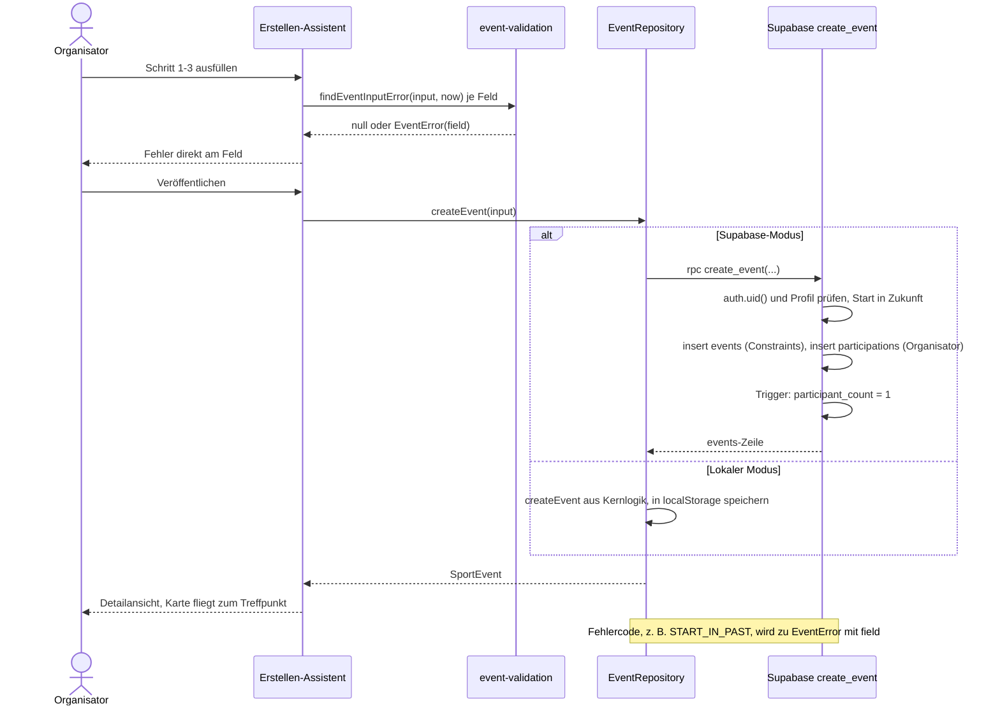
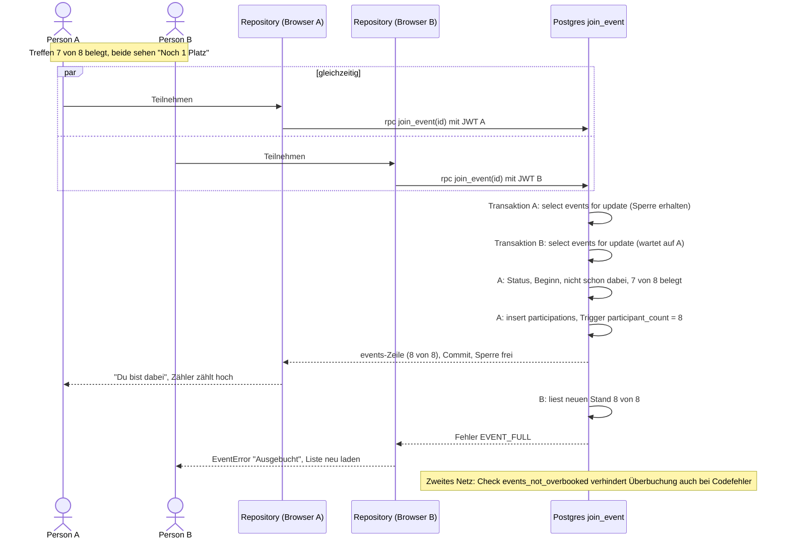
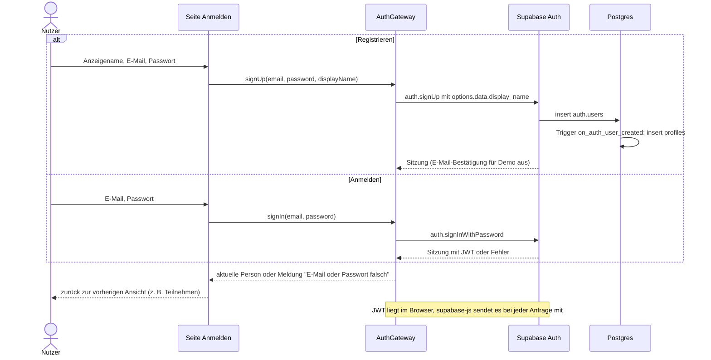
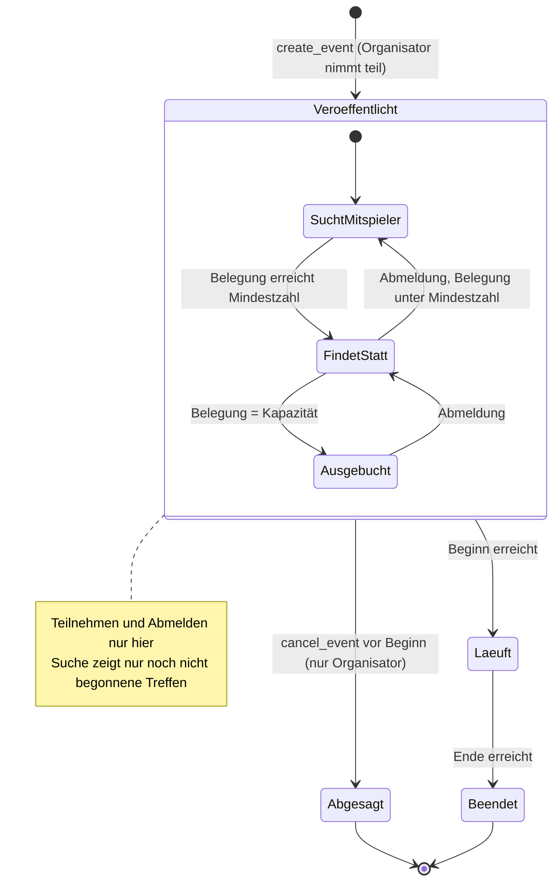
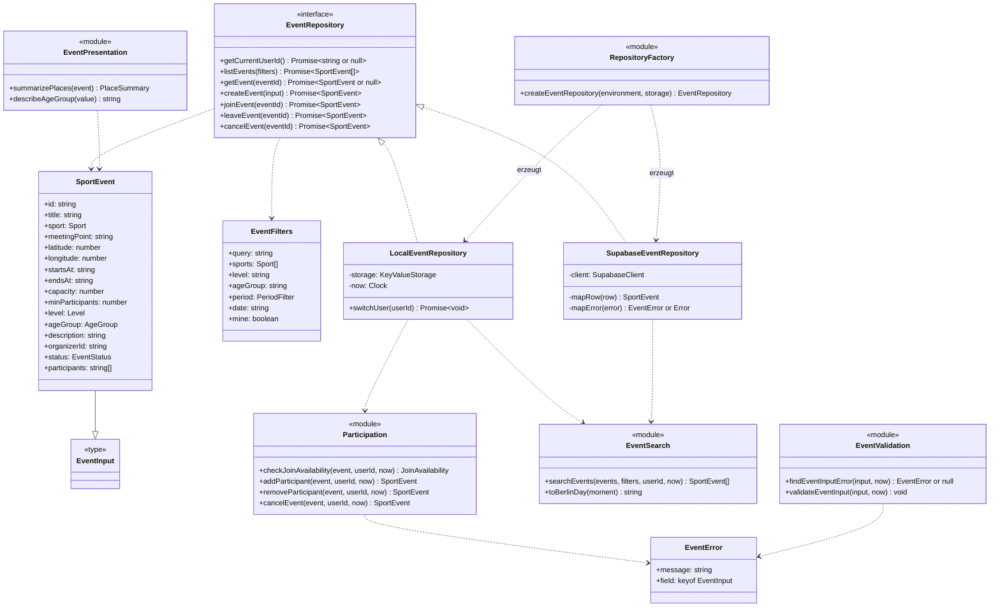
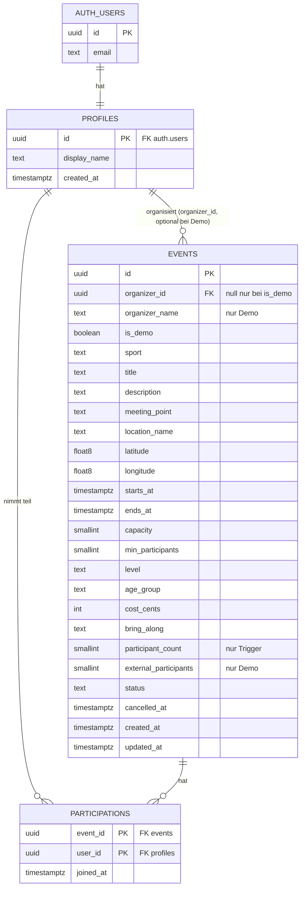
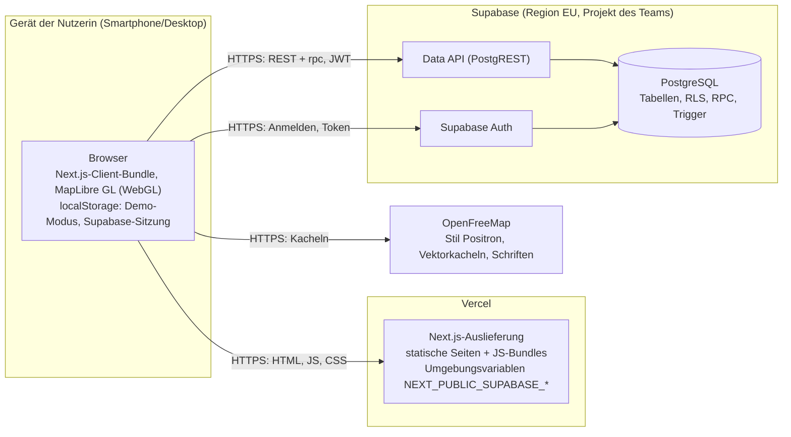

# SportMate – Architektur und Entwurf

| | |
| --- | --- |
| Projekt | SportMate – Hochschul-Softwareprojekt, Wintersemester 2026/27 |
| Team | Julien, Renat, Paulo, Niklas |
| Hauptverantwortlich | Renat (Rolle „Architektur und Entwurf“ laut Präsentation 1 vom 30.09.2026; vom Team zu bestätigen) |
| Autorinnen und Autoren mit Anteil in % | |
| Stand | Entwurf vom 23.11.2026, zusammengestellt von der Agentenrolle reporter aus `docs/architecture.md` und `docs/decisions/` |
| Repository | <https://github.com/Paulo-Temme/SportMate> (Branch `develop`) |
| Live-App | <https://sportmate-gamma.vercel.app> |

<div class="pagebreak"></div>

## Inhalt

1. Überblick und Notation
2. Architekturtreiber und Randbedingungen
3. Architekturstil, Begründung und verworfene Alternativen
4. Bausteine und Schnittstellen (Komponentensicht)
5. Verhalten (Sequenz- und Zustandsdiagramme)
6. Detailentwurf (Klassendiagramm)
7. Datenmodell (ER-Diagramm) und Sicherheitskonzept
8. Verteilungssicht
9. Entwurfsprinzipien und wo sie im Code sichtbar sind
10. Entscheidungen (ADR 0001–0010)
11. Nachvollziehbarkeit Anforderung → Realisierung
12. Risiken und offene Punkte
13. Lücken

Abkürzungen: **ADR** = Architecture Decision Record (Entscheidungsnotiz) · **RLS** = Row Level Security, Zugriffsregeln
je Tabellenzeile in PostgreSQL · **RPC** = Remote Procedure Call, hier: Postgres-Funktion, die die App über Supabase
aufruft · **JWT** = JSON Web Token, Anmeldenachweis im Browser · **UI** = Oberfläche · **SSR** = serverseitiges Rendern.

## 1. Überblick und Notation

SportMate ist eine mobile Web-App (Next.js) mit Supabase als verwaltetem Backend. Die Karte ist der Startbildschirm,
die Trefferliste liegt in einem Bottom Sheet darüber. Ohne Supabase-Konfiguration läuft dieselbe App im lokalen
Demo-Modus vollständig im Browser.

Status der Architektur: Entwurf vom 23.11.2026 (Rolle architect), Freigabe durch das Team offen. Übernommen und
weiterentwickelt aus der Architektur von Präsentation 3 (27.10.2026) (`docs/architecture.md`, Abschnitt Änderungen).

Alle Diagramme in Mermaid, damit sie im Repo versioniert und im Pull Request geprüft werden.

| Sicht | Diagrammart | Warum diese |
| --- | --- | --- |
| Bausteine und Abhängigkeiten | Komponentendiagramm (Flowchart) | zeigt Module und die erlaubten Abhängigkeitsrichtungen auf einen Blick |
| Abläufe zwischen Bausteinen | Sequenzdiagramm | zeigt Reihenfolge der Aufrufe über Modul- und Systemgrenzen, auch Nebenläufigkeit (`par`) |
| Zustände eines Treffens | Zustandsdiagramm | ein Treffen hat gespeicherte und abgeleitete Zustände mit klaren Übergängen |
| Struktur der Kernlogik | Klassendiagramm | zeigt Typen, Schnittstelle und Umsetzungen; Module ohne Klassen als `<<module>>` |
| Daten | ER-Diagramm + Feldtabelle | Beziehungen und Kardinalitäten; Regeln stehen in der Tabelle |
| Verteilung | Flowchart mit Knoten je Laufzeitumgebung | Mermaid hat kein eigenes Verteilungsdiagramm; Subgraphen stellen Knoten dar |

## 2. Architekturtreiber und Randbedingungen

`docs/vision.md` ist noch eine Vorlage. Die Qualitätsziele unten sind daher **Annahmen des architect**
auf Basis von `docs/design.md`, den Vorgaben des Teams und der P3-Vorarbeit. Mit der Vision abgleichen (offen).

| Qualitätsmerkmal | Konkrete Anforderung | Folge für die Architektur |
| --- | --- | --- |
| 1. Bedienbarkeit (mobil) | Treffen in der Nähe in wenigen Sekunden finden; App wirkt wie eine native Mobile-App; Karte nicht fremd (Prototyp-Kritik, design.md) | Mobile-first, Karte als Startbildschirm, Bottom Sheet (ADR-0005); Vektorkarte mit Tokens (ADR-0004); Karte und Liste aus einer Trefferquelle |
| 2. Korrektheit/Zuverlässigkeit der Teilnahme | Ein Treffen wird nie überbucht, auch wenn zwei Personen gleichzeitig den letzten Platz nehmen | Atomare Postgres-Funktionen mit Zeilensperre + Check-Constraint (ADR-0006) |
| 3. Sicherheit und Datenschutz | Nur eigene Teilnahmen lesbar; Fremde sehen Belegung, nicht Namen; keine E-Mail öffentlich; keine Demo-Identitäten auf dem Server | RLS je Tabelle, Schreiben nur per RPC mit `auth.uid()` (ADR-0002, ADR-0007); Profile nur mit Anzeigename |
| 4. Wartbarkeit/Testbarkeit | Kernlogik per Mutation Testing prüfbar; Tests ohne Server und Netz; Agenten arbeiten parallel | Reine Kernlogik in `src/lib/events` ohne I/O; Repository-Schnittstelle mit lokaler Umsetzung (ADR-0003); kleine Dateien mit einer Aufgabe |
| 5. Verfügbarkeit in der Demo | Präsentation funktioniert ohne Netz und ohne Supabase | Lokaler Demo-Modus, Karten-Fallback "Karte offline" |

Quelle für Qualitätsmerkmale als Architekturtreiber: Len Bass, Paul Clements, Rick Kazman,
"Software Architecture in Practice", 3. Auflage, 2012.

### Randbedingungen
- Technik: Next.js (App Router) + TypeScript, Vitest, Playwright; SE-Eval misst ohne Umbau (CLAUDE.md).
- Backend Supabase (Auth, Postgres, RLS), Hosting Vercel, Karte MapLibre GL + OpenFreeMap, Animation `motion`.
- Budget: kostenlose Tarife; kein kostenpflichtiger Kartendienst, kein API-Key für die Karte.
- Zeit: Semesterprojekt, kleines Team; Agentenprozess mit Freigabepunkten (`docs/prozess.md`).
- Recht: DSGVO – Datensparsamkeit, keine Standortspeicherung, Hinweis auf externe Kartenkacheln (offen).
- Keine Secrets im Code, kein `service_role`-Schlüssel in der App.
- Alle Texte deutsch; Gestaltung verbindlich nach `docs/design.md`.

## 3. Architekturstil, Begründung und verworfene Alternativen

**Modularer Monolith** (eine Next.js-Anwendung) mit **Schichten innerhalb des Browsers** und einem
verwalteten Backend (Supabase) als zweitem Laufzeitknoten. Innerhalb der App: Oberfläche → Kernlogik,
Oberfläche → Datenzugriff (Schnittstelle), Datenzugriff → Kernlogik; die Kernlogik hängt von nichts ab
(Präzisierung der CLAUDE.md-Regel, Freigabe nötig: ADR-0003).

Verworfene Alternativen: getrenntes REST-Backend oder Microservices (zu viel Betrieb für eng gekoppelte
Abläufe, ADR-0001); eigene Route-Handler-Schicht zwischen Browser und Supabase (kein Sicherheitsgewinn
gegenüber RLS, ADR-0007). Quellen: Martin Fowler, "MonolithFirst" (2015); Repository-Muster nach
Martin Fowler, "Patterns of Enterprise Application Architecture" (2002).

## 4. Bausteine und Schnittstellen (Komponentensicht)

### 4.1 Bausteine



Konnektoren: **K1** TypeScript-Aufruf über die Schnittstelle (asynchron, Promise); **K2** HTTPS zur
Supabase Data API (PostgREST: Tabellenlesen, `rpc()`), Nutzer-JWT im Header; **K3** HTTPS zu Supabase Auth
(E-Mail/Passwort, Sitzung im Browser); **K4** HTTPS zu OpenFreeMap (Stil-JSON, Vektorkacheln, Schriften).

| Baustein | Aufgabe | Darf abhängen von | Verbirgt (Information Hiding) |
| --- | --- | --- | --- |
| Seiten (`src/app`) | Routen, Seitenzustand, Verdrahtung von Repository und Komponenten | Komponenten, Kernlogik, `EventRepository`, `createEventRepository` | – |
| Kartenbühne (`components/map`) | MapLibre initialisieren, Tokens anwenden, Marker, Flug zum Treffen, Fallback "Karte offline" | `src/lib/map`, Kernlogik-Typen | MapLibre-API, Stil-Layer-Namen |
| Bottom Sheet / Liste / Detail | Rastpunkte, Gesten, Trefferliste, Detailansicht, Teilnehmen-Knopf | Kernlogik (Presentation, Participation-Vorabprüfung) | Gestenberechnung, Animation (`motion`) |
| Erstellen-Assistent | Drei Schritte, Feldvalidierung | `event-validation`, `EventRepository` | Schrittzustand |
| `src/lib/events` | Fachregeln: Validierung, Suche/Filter, Teilnahmeregeln, abgeleitete Zustände, Anzeigetexte | nichts (nur Standard-JS, `Intl`) | Regeldetails hinter wenigen exportierten Funktionen |
| `src/lib/map` (geplant) | reine Kartenlogik: Treffen → Marker-Daten, Stil-Anpassungen als Daten | Kernlogik-Typen | – |
| `EventRepository` | Vertrag für Lesen/Schreiben von Treffen | Kernlogik-Typen | Speicherort |
| `LocalEventRepository` | Demo-Modus: Zustand in localStorage, Demopersonen, tägliches Neu-Befüllen | Kernlogik | Speicherschlüssel, JSON-Format |
| `SupabaseEventRepository` | Supabase-Modus: Abfragen, RPC-Aufrufe, Abbildung Zeile ↔ `SportEvent`, Fehlercode → `EventError` | Kernlogik-Typen, `@supabase/supabase-js` | Tabellen-/Spaltennamen, SQL-Fehlercodes |
| `AuthGateway` (geplant) | Anmelden, Registrieren, Abmelden, aktuelle Person | `@supabase/supabase-js` bzw. Demopersonen | Sitzungsdetails |
| `repository-factory` | Wahl lokal/Supabase anhand der Umgebungsvariablen | beide Umsetzungen | Konfiguration |
| Supabase (extern) | Konten, Sitzungen, Daten, RLS, atomare Fachoperationen | – | Passwörter, Sperren, Rechte |

### 4.2 Schnittstellen

Was ein Baustein anderen anbietet. Alles andere ist intern.

#### EventRepository (`src/lib/data/event-repository.ts`)
Stand: so vom Datenzugriffs-Agenten am 23.11.2026 angelegt; Vor-/Nachbedingungen hier verbindlich ergänzt.
Alle Methoden asynchron. Fachfehler: `EventError` mit deutscher Meldung (optional `field`);
technische Fehler (Netz, unerwartet): `Error`.

| Funktion (Signatur) | Vorbedingung | Nachbedingung | Fehlerfälle (SQL-Code → Meldung) |
| --- | --- | --- | --- |
| `getCurrentUserId(): Promise<string \| null>` | – | Kennung der angemeldeten Person oder `null` (Gast) | Netzfehler → `Error` |
| `listEvents(filters?: EventFilters): Promise<SportEvent[]>` | – | Treffer nach `searchEvents` (ADR-0009), aufsteigend nach Beginn; ohne `mine`: nur veröffentlichte, noch nicht begonnene | Netzfehler → `Error` |
| `getEvent(eventId: string): Promise<SportEvent \| null>` | – | Treffen oder `null`, wenn unbekannt; auch abgesagte | Netzfehler → `Error` |
| `createEvent(input: EventInput): Promise<SportEvent>` | angemeldet; `input` erfüllt `validateEventInput` | neues Treffen `published`, Organisator = aktuelle Person, Belegung 1 | `AUTH_REQUIRED` → "Bitte zuerst anmelden."; `PROFILE_MISSING` → "Profil fehlt. Bitte neu anmelden."; `START_IN_PAST` → "Der Termin muss in der Zukunft liegen." (field `startsAt`); `INVALID_INPUT` (detail = Constraint) → Feldmeldung aus `event-validation` |
| `joinEvent(eventId: string): Promise<SportEvent>` | angemeldet | Person ist Teilnehmende; bereits dabei → unverändert (idempotent); Belegung ≤ Kapazität | `AUTH_REQUIRED`; `EVENT_NOT_FOUND` → "Dieses Treffen gibt es nicht."; `EVENT_CANCELLED` → "Das Treffen ist abgesagt."; `EVENT_STARTED` → "Das Treffen hat bereits begonnen."; `EVENT_FULL` → "Ausgebucht" |
| `leaveEvent(eventId: string): Promise<SportEvent>` | angemeldet, nicht Organisator | Person ist nicht mehr Teilnehmende; war nicht dabei → unverändert | `AUTH_REQUIRED`; `EVENT_NOT_FOUND`; `ORGANIZER_CANNOT_LEAVE` → "Als organisierende Person kannst du das gesamte Treffen absagen."; `EVENT_CANCELLED`; `EVENT_STARTED` |
| `cancelEvent(eventId: string): Promise<SportEvent>` | angemeldet, Organisator | Status `cancelled` (endgültig); bereits abgesagt → unverändert | `AUTH_REQUIRED`; `EVENT_NOT_FOUND`; `NOT_ORGANIZER` → "Nur die organisierende Person darf das Treffen absagen."; `EVENT_STARTED` |

Nur lokal: `LocalEventRepository.switchUser(userId: string | null)` wählt eine Demoperson (Fehler:
keine Demoperson). Nur Supabase (geplant): `listParticipants(eventId)` über RPC `list_event_participants`
(`NOT_PARTICIPANT` → "Nur Teilnehmende sehen die Liste.").

#### Kernlogik (`src/lib/events`, Auswahl)
| Modul | Funktion | Zweck | Fehlerfälle |
| --- | --- | --- | --- |
| event-validation | `findEventInputError(input, now): EventError \| null`, `validateEventInput(input, now): void` | erstes ungültiges Feld in Formularreihenfolge | wirft `EventError` (nur `validate…`) |
| event-search | `searchEvents(events, filters, userId, now): SportEvent[]`, `toBerlinDay(moment): string` | Filtern/Sortieren, Kalendertag Berlin | `RangeError` bei ungültigem Datum |
| participation | `checkJoinAvailability(event, userId, now)`, `addParticipant`, `removeParticipant`, `cancelEvent` | Vorabprüfung für Knopf; Regeln im Demo-Modus | `EventError` |
| event-creation | `createEvent(input, userId, eventId, now): SportEvent` | neues Treffen, Organisator nimmt teil | `EventError` |
| event-presentation | `summarizePlaces(event)`, `describeAgeGroup(value)`, Zustand | Anzeigetexte ("Noch 3 Plätze"), abgeleiteter Zustand | wirft nicht |

#### Supabase-RPC (Postgres-Funktionen, `supabase/migrations/0001_initial_schema.sql`)
Alle `security definer`, `set search_path = ''`, nur `authenticated` darf ausführen, Identität aus `auth.uid()`.

| Funktion | Rückgabe | Fehlercodes |
| --- | --- | --- |
| `create_event(p_sport text, p_title text, p_meeting_point text, p_latitude float8, p_longitude float8, p_starts_at timestamptz, p_ends_at timestamptz, p_capacity int, p_min_participants int = 2, p_level text = 'Alle Niveaus', p_age_group text = '', p_description text = '', p_location_name text = '', p_cost_cents int = 0, p_bring_along text = '')` | `events`-Zeile | `AUTH_REQUIRED`, `PROFILE_MISSING`, `START_IN_PAST`, `INVALID_INPUT` (detail: Constraint-Name) |
| `join_event(p_event_id uuid)` | `events`-Zeile | `AUTH_REQUIRED`, `PROFILE_MISSING`, `EVENT_NOT_FOUND`, `EVENT_CANCELLED`, `EVENT_STARTED`, `EVENT_FULL` |
| `leave_event(p_event_id uuid)` | `events`-Zeile | `AUTH_REQUIRED`, `PROFILE_MISSING`, `EVENT_NOT_FOUND`, `ORGANIZER_CANNOT_LEAVE`, `EVENT_CANCELLED`, `EVENT_STARTED` |
| `cancel_event(p_event_id uuid)` | `events`-Zeile | `AUTH_REQUIRED`, `PROFILE_MISSING`, `EVENT_NOT_FOUND`, `NOT_ORGANIZER`, `EVENT_STARTED` |
| `list_event_participants(p_event_id uuid)` | `table(user_id uuid, display_name text, is_organizer boolean)` | `AUTH_REQUIRED`, `PROFILE_MISSING`, `EVENT_NOT_FOUND`, `NOT_PARTICIPANT` |

Fehlerformat: supabase-js liefert `error.message === '<CODE>'` (SQLSTATE `P0001`), bei `INVALID_INPUT`
zusätzlich `error.details`. Unbekannte Codes → allgemeine Meldung "Das hat nicht geklappt. Bitte später
erneut versuchen." Die Abbildung Code → Meldung steht genau einmal in `SupabaseEventRepository`.

### 4.3 Ordnerstruktur

```
src/
  app/                      Routen (App Router): page.tsx = Entdecken, meine-treffen/, erstellen/, profil/, anmelden/
  components/
    map/                    Kartenbühne (MapLibre, Marker, Fallback), nur Client
    sheet/                  Bottom Sheet mit Rastpunkten
    event/                  Trefferkarte, Detailansicht, Teilnehmen-Knopf
    create-event/           Erstellen-Assistent (3 Schritte)
    navigation/             Tab-Leiste (mobil), Seitenleiste (Desktop)
    ui/                     Grundelemente (Button, Chip, Feld) nach design.md
  lib/
    events/                 Kernlogik Treffen (rein): event-model, event-validation, event-search,
                            participation, event-creation, event-presentation, list-order,
                            event-error, acting-user, demo-events, demo-people
    map/                    reine Kartenlogik (geplant): Marker-Daten, Stil-Anpassung
    data/                   Datenzugriff: event-repository (Schnittstelle), local-event-repository,
                            supabase-event-repository, repository-factory, auth-gateway (geplant)
e2e/                        Playwright-Akzeptanztests (lokaler Modus, Karten-Fallback)
tests/integration/          Vitest-Integrationstests (z. B. Vertragstests für beide Repositories)
supabase/
  migrations/0001_initial_schema.sql
  seed.sql
  README.md
docs/decisions/             ADRs
```
Mutation Testing (SE-Eval/Stryker) zielt auf `src/lib/`. `demo-events.ts`/`demo-people.ts` sind Daten
und können dort ausgenommen werden (Vorschlag).

## 5. Verhalten (Sequenz- und Zustandsdiagramme)

### Treffen suchen (Entdecken)


### Treffen erstellen


### Teilnehmen inkl. Konkurrenzfall "letzter Platz"


### Anmeldung (Supabase-Modus; Demo-Modus: Demoperson wählen)


### Zustände eines Treffens
Gespeichert sind nur `published` und `cancelled`. Alle anderen Zustände leitet `event-presentation`
aus Zeit, Belegung und Mindestzahl ab (keine doppelte Speicherung, P3 ADR-07).



## 6. Detailentwurf (Klassendiagramm)

Typen und Dienste der Kernlogik und des Datenzugriffs. `<<module>>` = Datei mit exportierten Funktionen,
keine Klasse.



**Nötige Erweiterung des Modells (offen, vor der Supabase-Story):** Im Supabase-Modus darf niemand die
Teilnehmerliste fremder Treffen lesen. `SportEvent` braucht daher `participantCount: number` (Belegung
inkl. externer Plätze) und `isViewerParticipant: boolean`; `participants` enthält dort höchstens die eigene
Kennung. `summarizePlaces` und `checkJoinAvailability` müssen auf `participantCount` umgestellt werden.
Für design.md (Schritt 3 "Kosten, Mitbringen") und Seed-Treffen zusätzlich: `locationName`, `costCents`,
`bringAlong`, `organizerName`, `isDemo`. Spaltennamen siehe Datenmodell.

Hinweis zum Stand: Die im Absatz oben als „offen“ genannte Modellerweiterung ist inzwischen umgesetzt. Laut
`specs/F-22/spec.md` (Abschnitt Entwurf) hat `SportEvent` keine öffentliche Teilnehmerliste mehr, sondern
`participantCount`, `isViewerParticipant`, `isViewerOrganizer`, `organizerName`, `locationName`, `costCents`,
`bringAlong`, `isDemo`; neu ist `EventRepository.listParticipants`. Für die Anmeldung kam laut `specs/F-01/spec.md` die
Schnittstelle `AuthGateway` (`getCurrentUser`, `signUp`, `signIn`, `signOut`, `onAuthChange`, `listDemoAccounts`,
`signInAsDemo`) mit lokaler und Supabase-Umsetzung hinzu; `repository-factory` wurde durch `data-services`
(`createDataServices(): { events, auth, mode }`) ersetzt. Das Klassendiagramm in `docs/architecture.md` ist darauf noch
nicht angepasst (siehe Lücken).

## 7. Datenmodell (ER-Diagramm) und Sicherheitskonzept

### 7.1 Datenmodell

Quelle: `supabase/migrations/0001_initial_schema.sql`. Konten selbst liegen in `auth.users` (Supabase).



| Entität | Feld | Typ | Regel |
| --- | --- | --- | --- |
| profiles | id | uuid | PK, FK `auth.users`, `on delete cascade` |
| profiles | display_name | text | 2–40 Zeichen (getrimmt); Trigger setzt ihn bei Registrierung |
| events | organizer_id | uuid | FK `profiles`, `on delete cascade`; NULL nur wenn `is_demo` und `organizer_name` gesetzt |
| events | sport | text | `Fußball`, `Volleyball`, `Badminton`, `Basketball`, `Laufen`, `Tischtennis` (wie `event-model.ts`) |
| events | title | text | 3–80 Zeichen |
| events | description | text | ≤ 300 Zeichen, Standard leer |
| events | meeting_point | text | 5–200 Zeichen (Treffpunktbeschreibung) |
| events | location_name | text | ≤ 80 Zeichen, Standard leer (Ortsname für Liste/Marker) |
| events | latitude / longitude | float8 | −90…90 / −180…180 |
| events | starts_at / ends_at | timestamptz | `ends_at > starts_at`, Dauer ≤ 12 h; Start in Zukunft (in `create_event`) |
| events | capacity | smallint | 2–50, inkl. Organisator |
| events | min_participants | smallint | 2…capacity, Standard 2 |
| events | level | text | `Alle Niveaus`, `Anfänger`, `Fortgeschritten`, `Erfahren` |
| events | age_group | text | leer (= alle), `unter 20`, `20–25`, `26–30`, `31–40`, `über 40` |
| events | cost_cents | int | 0–10000, 0 = kostenlos |
| events | bring_along | text | ≤ 200 Zeichen |
| events | participant_count | smallint | ≥ 0, nur Trigger schreibt |
| events | external_participants | smallint | ≥ 0, nur Seed (ADR-0008) |
| events | (Tabelle) | – | `participant_count + external_participants <= capacity` |
| events | status / cancelled_at | text / timestamptz | `published`/`cancelled`; `cancelled_at` genau bei `cancelled` gesetzt |
| participations | (event_id, user_id) | uuid, uuid | PK (keine Doppelteilnahme); beide `on delete cascade` |

Indizes: `events(starts_at) where status='published'` (Suche), `events(organizer_id)`,
`participations(user_id)` (Meine Treffen).

### 7.2 Sicherheitskonzept

Grundsatz: Der Browser ist nicht vertrauenswürdig. Schutz entsteht ausschließlich in Supabase durch
Grants, RLS und geprüfte Funktionen (ADR-0007). Kernlogik im Browser ist nur Bedienhilfe.

| Tabelle | anon | authenticated | Policy / Begründung |
| --- | --- | --- | --- |
| profiles | SELECT | SELECT; UPDATE nur Spalte `display_name` der eigenen Zeile | `profiles_select_all` (Organisatorname öffentlich, keine E-Mail); `profiles_update_own`: `id = auth.uid()` |
| events | SELECT | SELECT | `events_select_all`: Karte ohne Anmeldung. Kein INSERT/UPDATE/DELETE-Recht; nur per RPC |
| participations | – | SELECT eigene Zeilen | `participations_select_own`: `user_id = auth.uid()`. Teilnehmerliste fremder Personen nur per `list_event_participants` (nur Mitglieder) |

Weitere Regeln:
- Tabellenrechte werden in der Migration ausdrücklich entzogen (`revoke all … from anon, authenticated`) und
  nur das Nötige gewährt; Supabase-Standardrechte gelten nicht.
- RPCs: `security definer`, `set search_path = ''`, alle Objekte schemaqualifiziert, Identität nur aus
  `auth.uid()` (nie als Parameter), `EXECUTE` nur für `authenticated`. Hilfs- und Triggerfunktionen im
  Schema `private`, das die Data API nicht freigibt.
- **Demo-Identitäten nie serverseitig:** Demopersonen (`demo-people.ts`) existieren nur im lokalen Modus
  im localStorage. Der Supabase-Modus kennt keine Demopersonen; Seed-Treffen haben kein Konto
  (`organizer_id` NULL, ADR-0008) und sind daher nicht steuerbar. Es gibt keine Demo-Passwörter.
- Kein `service_role`-Schlüssel in der App oder in `NEXT_PUBLIC_*`. Der anon key ist öffentlich (beabsichtigt).
- Passwörter verwaltet Supabase Auth. Mindestlänge in Supabase und Oberfläche gleich (8 oder 12, offen).
- E-Mail-Bestätigung für die Demo aus (`supabase/README.md`), vor echtem Betrieb ein (offen).
- Datenschutz: kein Gerätestandort gespeichert; Kartenkacheln von OpenFreeMap übertragen IP und Ausschnitt
  (Hinweis in der App, offen). Konto löschen kaskadiert auf Profil, eigene Treffen und Teilnahmen.
- Eingaben werden als Text gerendert (React escaped); keine HTML-Einbettung von Nutzertexten.

## 8. Verteilungssicht



Im lokalen Demo-Modus entfallen die Verbindungen zu Supabase; ohne Netz zusätzlich OpenFreeMap
(Fallback "Karte offline"). Vercel führt keine eigene Fachlogik aus.

Betrieb (Stand 23.11.2026): Die App ist unter <https://sportmate-gamma.vercel.app> auf Vercel bereitgestellt; Daten
liegen in einem Supabase-Projekt des Teams. Schema per Migration, Demodaten per `supabase/seed.sql`.

## 9. Entwurfsprinzipien und wo sie im Code sichtbar sind

- **Modularisierung / hohe Kohäsion:** Eine Datei, eine Aufgabe (Validierung, Suche, Teilnahme, Anzeige
  getrennt). UI-Bausteine nach Bildschirmbereich (Karte, Sheet, Erstellen).
- **Information Hiding** (David L. Parnas, "On the Criteria To Be Used in Decomposing Systems into
  Modules", 1972): Speicherort, Tabellen- und Fehlercodes verbirgt das Repository; MapLibre-Details
  verbirgt die Kartenbühne; Sperren und Rechte verbirgt die Datenbank.
- **Lose Kopplung:** Oberfläche kennt nur `EventRepository`; Umschaltung an genau einer Stelle (Factory).
  Kernlogik ohne Abhängigkeiten.
- **Bewusste Abweichungen:** (1) Fachregeln für Teilnahme doppelt in TS und SQL (ADR-0003, ADR-0006),
  abgesichert durch gleiche Fehlerfälle in Vertragstests. (2) Wertelisten doppelt in TS und SQL-Check
  (ADR-0009). (3) Abhängigkeitsrichtung Datenzugriff → Kernlogik (ADR-0003, Freigabe nötig).
  (4) Belegungszähler als gespeicherte Ableitung (ADR-0006).

Belege aus dem Review vom 23.11.2026 (`docs/testing/review-protokoll.md`, „Positive Feststellungen“):

| Prinzip | Prüfpunkt | Beleg im Code |
| --- | --- | --- |
| Abhängigkeitsrichtung | E2 | `src/lib/events` und `src/lib/auth` importieren nichts aus `src/lib/data`, `src/components`, `src/app`, `src/hooks` (Suche ohne Treffer) |
| Information Hiding | E3 | keine Komponente, Seite oder Hook importiert `@supabase/*`; die Oberfläche kennt nur `EventRepository`, `AuthGateway`, `data-services` (`src/components/app/app-services.tsx`) |
| Nichts doppelt | E6 | Teilnahme-Button-Logik einmal in `resolveJoinAction`, von Liste und Detail genutzt; Fehlertexte der Datenbankcodes an einer Stelle (`supabase-error-translation.ts`) |
| Sicherheitsgrenze in der Datenbank | S1–S3 | RLS auf allen Tabellen; Schreiben nur per RPC mit `security definer`, `search_path = ''`, `auth.uid()`; Zeilensperre `select … for update` plus Check-Constraint `events_not_overbooked` |

Bekannte Verstöße aus demselben Review: doppelte „Heute/Morgen“-Logik in der Oberfläche (`src/components/event/day-label.ts`,
REV-04), harte Farbwerte statt Design-Tokens (REV-07), 12-Stunden-Regel nur in SQL, nicht in der Kernlogik (REV-01/BUG-04),
Kostenobergrenze TS 5000 Cent vs. SQL 10000 Cent (REV-08).

## 10. Entscheidungen (ADR 0001–0010)

Format nach Michael Nygard, „Documenting Architecture Decisions“ (2011). Alle Notizen vom 23.11.2026 (0001–0009 Rolle
architect, 0010 Rolle coder im Auftrag des Orchestrators), Status „vorgeschlagen“, Freigabe durch das Team offen
(`docs/decisions/README.md`).

| Nr. | Entscheidung | Wichtigste verworfene Alternativen | Begründung (Kurzfassung) | Quelle/Literatur |
| --- | --- | --- | --- | --- |
| 0001 | Modularer Monolith mit Next.js (App Router), Module mit festen Abhängigkeitsrichtungen | React-SPA + eigenes REST-Backend; Microservices; statische Seite | eng gekoppelte Abläufe, kleines Team, SE-Eval-Stack; Modulgrenzen über Regeln, Review und Lint | Fowler, „MonolithFirst“ (2015) |
| 0002 | Supabase (Auth, PostgreSQL, RLS, RPC) statt eigenem Backend | eigene Route Handler + ORM + Auth; Firebase; selbst betriebenes PostgreSQL | keine eigene Passwortverwaltung, kein Serverbetrieb, SQL-Constraints für Kapazität und Eindeutigkeit, kostenloser Tarif | – |
| 0003 | Schnittstelle `EventRepository` mit lokaler und Supabase-Umsetzung; Demo-Modus | nur Supabase mit Demo-Projekt; Supabase lokal per Docker; Mock Service Worker | Präsentation und Tests ohne Netz; Oberfläche kennt den Speicherort nicht; bewusste Präzisierung der Abhängigkeitsrichtung (Datenzugriff → Kernlogik) | Fowler, „Patterns of Enterprise Application Architecture“ (2002) |
| 0004 | MapLibre GL + OpenFreeMap Positron statt Leaflet-Rasterkarte | Leaflet + OSM-Raster (P3); Leaflet + Vektor-Plugin; Mapbox/Google; eigener Tile-Server | Vektorkarte in App-Farben umfärbbar, kein API-Key, OSM-Standardkacheln nicht für Produktivbetrieb gedacht; Fallback „Karte offline“ Pflicht | Tile-Nutzungsrichtlinie der OSMF (genannt, nicht zitiert) |
| 0005 | Mobile-first: Karte als Startbildschirm, Bottom Sheet mit drei Rastpunkten | Liste als Startseite; Desktop-first; getrennte Seiten ohne Sheet | Zielgerät Smartphone (Annahme), Designentscheidung `docs/design.md`; eine Trefferquelle für Karte und Liste | `docs/design.md` |
| 0006 | Atomare Teilnahme per Postgres-Funktion mit Zeilensperre, Zähler per Trigger, Check-Constraint | Button deaktivieren; zählen und einfügen aus dem Client; nur Constraint; SERIALIZABLE | Überbuchung auch bei gleichzeitigen Klicks und direkten API-Aufrufen ausgeschlossen; stabile Fehlercodes; Idempotenz | PostgreSQL-Dokumentation, „Explicit Locking“ |
| 0007 | Datenzugriff direkt aus dem Browser mit supabase-js und RLS | Route Handler/Server Actions als Zwischenschicht (P3); Server-Komponenten mit `@supabase/ssr` | Zwischenschicht ohne Sicherheitsgewinn, da RLS und Funktionen schützen; Demo-Modus läuft ohnehin im Browser | – |
| 0008 | Seed-Treffen ohne Konto (`organizer_id` NULL nur bei `is_demo`, `external_participants`) | fiktive Konten in `auth.users`; Seed-Konten per Admin-API; keine Seed-Daten | keine leere Karte in der Demo, keine Demo-Identitäten auf dem Server, kein `service_role`-Schlüssel | – |
| 0009 | Suche und Filter in der Kernlogik (`searchEvents`) statt in der Datenbank | Filtern per SQL/PostgREST; PostGIS-Umkreissuche; technische Schlüssel + Mapping | beide Modi filtern identisch, Karte und Liste zeigen dasselbe; kleine Datenmenge | – |
| 0010 | Demo-Modus hält Treffen nur im Arbeitsspeicher; Konten und Sitzung im `localStorage`; Produktion nutzt ausschließlich Supabase | Treffen in `localStorage` (ursprünglich ADR-0003); `sessionStorage`; Demo gegen eigenes Supabase-Projekt | jede Vorführung und jeder E2E-Test startet mit demselben Stand; Banner „Änderungen gehen beim Neuladen verloren“; präzisiert ADR-0003 | – |

Abweichungen gegenüber der Architektur aus Präsentation 3: MapLibre statt Leaflet (ADR-0004), Datenzugriff aus dem
Browser statt Route Handler (ADR-0007), gespeicherter Belegungszähler statt reiner Ableitung (ADR-0006), Repository und
Demo-Modus (ADR-0003). Zurückgestellt: Hinweise/Benachrichtigungen, Treffen bearbeiten, Buchungspilot, Profile mit Sportarten.

## 11. Nachvollziehbarkeit Anforderung → Realisierung

Die Tabelle in `docs/architecture.md` trägt noch Platzhalter-IDs („F-xx“), weil sie vor dem Backlog entstand. Unten sind
die Story-IDs aus `docs/backlog.md` zugeordnet (Zuordnung durch den reporter über die Story-Titel; vom Team zu prüfen).

| Story | Bausteine | Schnittstellen | Daten |
| --- | --- | --- | --- |
| F-05, F-08 Treffen in Liste und auf der Karte | Seite Entdecken, Kartenbühne, Bottom Sheet | `listEvents`, `searchEvents`, `summarizePlaces` | events (SELECT anon) |
| F-06, F-07, F-09 Filtern (Sportart, Zeit, Niveau, Alter, Text) | Bottom Sheet/Chips, Filterdialog, event-search | `listEvents(filters)` | events |
| F-12, F-13, F-14 Details | Sheet-Detail, event-presentation | `getEvent` | events, profiles (Organisatorname) |
| F-17 Treffen erstellen | Erstellen-Assistent, event-validation | `createEvent` → `create_event` | events, participations |
| F-22 Teilnehmen (inkl. letzter Platz) | Teilnehmen-Knopf, participation | `joinEvent` → `join_event` | participations, events.participant_count |
| F-23 Teilnahme zurückziehen | Detail, participation | `leaveEvent` → `leave_event` | participations |
| F-18 Treffen absagen | Detail, participation | `cancelEvent` → `cancel_event` | events.status |
| F-01, F-02 Registrieren und anmelden | Seite Anmelden, AuthGateway | `signUp`, `signIn`, `signOut` | auth.users, profiles (Trigger) |
| F-24 Meine Treffen | Seite Meine Treffen | `listEvents({ mine: true })` | participations (eigene) |
| F-32 Demo-Modus | data-services, LocalEventRepository, LocalAuthGateway | `createDataServices` | Arbeitsspeicher, localStorage (Konten, Sitzung) |
| F-20 Teilnehmerliste | Detail | `listParticipants` → `list_event_participants` | participations, profiles |

## 12. Risiken und offene Punkte

- **Freigaben des Menschen:** Abhängigkeitsrichtung (ADR-0003); Migration und Seed (Rechte/Schema) lesen.
- **SQL nicht ausgeführt:** Migration und Seed sind ungetestet. Erst auf leerem Projekt anwenden, Prüfschritte
  in `supabase/README.md`. Speziell prüfen: Trigger in Schema `private` feuert für `supabase_auth_admin`
  (Registrierung und Konto-Löschung).
- **Paralleltest fehlt:** Überbuchungsschutz ist nur durch Entwurf und manuellen `psql`-Test belegt.
- **Modellerweiterung:** `participantCount`, `isViewerParticipant`, `locationName`, `costCents`, `bringAlong`,
  `organizerName`, `isDemo` im TS-Modell fehlen noch (siehe Detailentwurf). Ohne sie kann
  `SupabaseEventRepository` `SportEvent` nicht ehrlich befüllen.
- **Doppelte Regeln TS/SQL:** Abweichungen möglich; Vertragstests für beide Repositories einplanen.
- **Koordinaten der Demotreffen** nicht nachgemessen; vor Demo prüfen (lokal und Seed gleich halten).
- **OpenFreeMap** ohne Verfügbarkeitszusage; Fallback ist Pflicht. Datenschutzhinweis zu Kacheln offen.
- **Supabase kostenloser Tarif:** Pausieren inaktiver Projekte möglich (Grenzen bei Einrichtung prüfen).
- **Passwortlänge** (8 vs. 12) und E-Mail-Bestätigung für echten Betrieb offen.
- **Vision und Qualitätsziele** noch Vorlage; Treiber oben sind Annahmen.
- Zurückgestellt (keine Story): Treffen bearbeiten, Hinweise/Benachrichtigungen, Umkreissuche/GPS,
  Profile mit Sportarten, Buchungspilot, Bewertungen.

Stand 23.11.2026 dazu (`docs/testing/testbericht.md`, `docs/testing/fehlerprotokoll.md`): Migration und Seed wurden
inzwischen gegen die Supabase-Datenbank ausgeführt (Integrationstests 2/2 grün nach Behebung von BUG-01, manuelle
Smoke-Tests TC-M-04 bis TC-M-10 bestanden). Der automatische Paralleltest fehlt weiterhin. Die Modellerweiterung ist
umgesetzt (siehe Abschnitt 6).

## 13. Lücken

Siehe auch `abgabe/LUECKEN.md`.

| Bewertungskriterium | Was fehlt | Was das Team nachliefern muss |
| --- | --- | --- |
| Vollständiger Detailentwurf | Klassendiagramm zeigt den Stand vor F-01/F-22 (ohne `AuthGateway`, `data-services`, neue Modellfelder); `LocalEventRepository` dort noch mit `localStorage` statt Arbeitsspeicher (ADR-0010) | Klassendiagramm in `docs/architecture.md` aktualisieren (Rolle architect) |
| Detailentwurf der Oberfläche | keine Diagramme für die React-Komponenten (Sheet, Karte, Assistent) | bei Bedarf Komponentendiagramm der Oberfläche |
| Aktivitätsdiagramm | in `docs/abgabe.md` genannt, nicht vorhanden (Sequenz- und Zustandsdiagramme liegen vor) | Aktivitätsdiagramm z. B. für „Treffen erstellen“ ergänzen oder begründen |
| Begründung aller Entscheidungen | alle ADRs „vorgeschlagen“, Freigabe offen; ADR-0003 verlangt ausdrücklich eine Freigabe der Abhängigkeitsrichtung; für ADR-0002/0007/0008/0009 keine Literaturquelle; neue npm-Abhängigkeiten ohne Notiz | Freigaben eintragen; Quellen ergänzen oder „Quelle offen“ begründen |
| Architekturtreiber | Treiber im Dokument noch als „Annahmen des architect“ markiert, obwohl die Vision inzwischen vorliegt | mit `docs/vision.md` abgleichen |
| Anforderung → Realisierung | Platzhalter-IDs in `docs/architecture.md` | Tabelle dort mit Story-IDs aktualisieren |
| Menschliches Review | Migration und Anmelde-/Datenzugriffsdateien laut Review-Protokoll noch nicht von einem Menschen gelesen | Review durchführen und vermerken |
