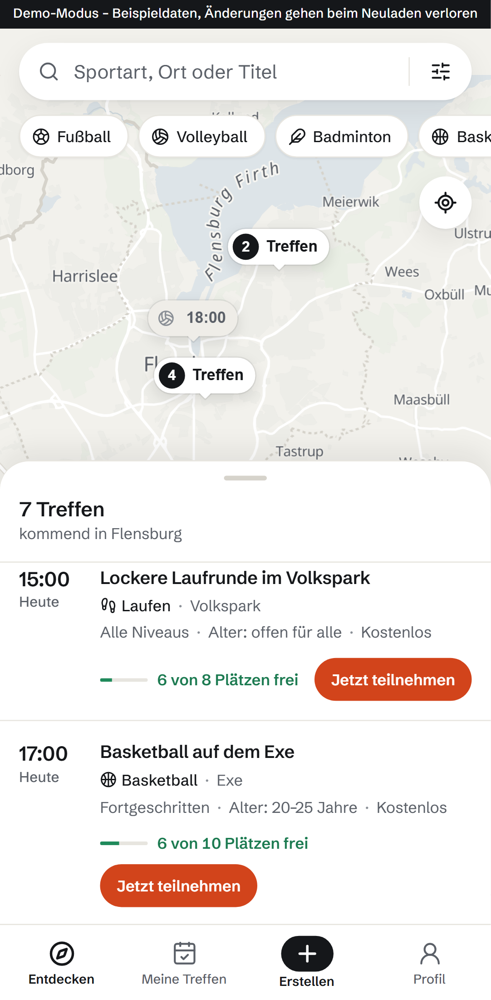
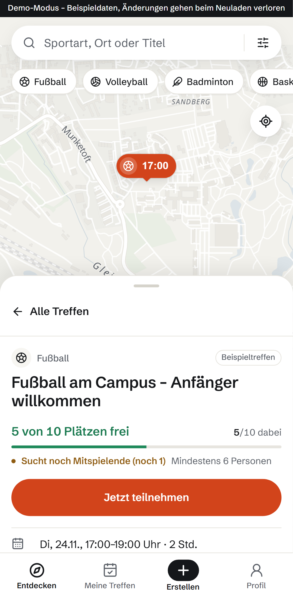
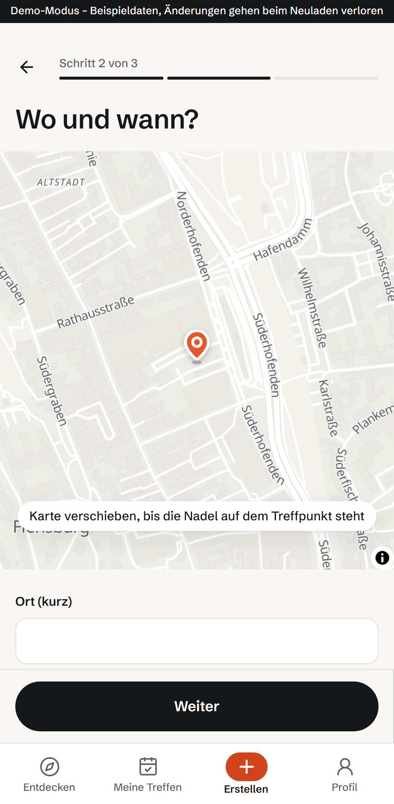
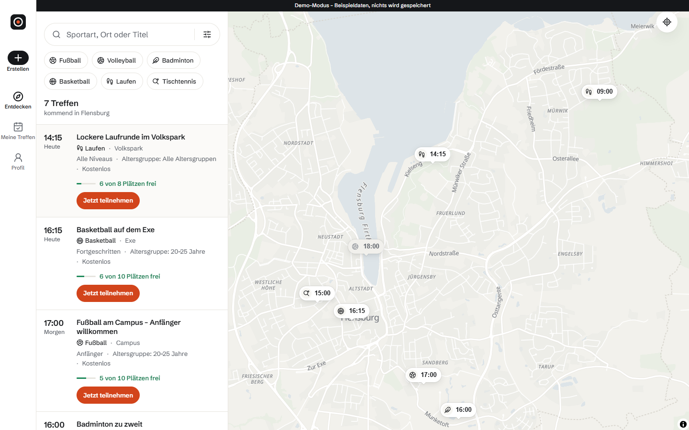

# SportMate – Lauffähige Software: Zugang, Start und Installation

| | |
| --- | --- |
| Projekt | SportMate – Hochschul-Softwareprojekt, Wintersemester 2026/27 |
| Team | Julien, Renat, Paulo, Niklas |
| Hauptverantwortlich | Paulo (Rolle „Implementierung“ laut Präsentation 1 vom 30.09.2026; vom Team zu bestätigen) |
| Autorinnen und Autoren mit Anteil in % | |
| Stand | Entwurf vom 23.11.2026, zusammengestellt von der Agentenrolle reporter aus `README.md`, `supabase/README.md`, `docs/einstieg.md` |

## 1. Gehostete Version (ohne Installation)

**<https://sportmate-gamma.vercel.app>** – im Browser öffnen, am besten auf dem Smartphone oder im mobilen Ansichtsmodus.
Die Version läuft auf Vercel; Konten und Treffen liegen in Supabase. Erreichbarkeit am 23.11.2026 geprüft (HTTP 200).

Kurzer Rundgang:

1. **Entdecken:** Karte mit Treffen in Flensburg, darunter das Bottom Sheet mit der Trefferliste. Sportart-Chip oder
   Suchleiste antippen, über „Filter“ Zeitraum, Niveau und Altersgruppe wählen.
2. **Details:** Ein Treffen antippen. Die Detailansicht zeigt Termin, Treffpunkt, Niveau, Alter, freie Plätze, Kosten,
   Mitbringen und Organisator; die Karte fliegt zum Treffpunkt.
3. **Mitmachen:** „Jetzt teilnehmen“ führt Gäste zur Anmeldung. Nach dem Registrieren (E-Mail, Passwort ab 8 Zeichen,
   Anzeigename) zurück zum Treffen und erneut „Jetzt teilnehmen“.
4. **Meine Treffen:** zeigt eigene und angemeldete Treffen; dort Teilnahme zurückziehen oder eigenes Treffen absagen.
5. **Erstellen:** Assistent in drei Schritten (Sportart und Titel – Ort auf der Karte und Zeit – Details).

Hinweis: Treffen aus den Demodaten tragen in der Detailansicht die Marke „Beispieltreffen“. Bitte keine echten persönlichen Daten eingeben;
für Tests genügt eine Wegwerf-E-Mail-Adresse (E-Mail-Bestätigung ist für die Demo ausgeschaltet).

Screenshots (Stand 23.11.2026, `docs/testing/screenshots/`, aufgenommen im Rahmen von F-05):

<div class="screens">

| Entdecken (mobil) | Detailansicht (mobil) | Erstellen, Schritt 2 (mobil) |
| --- | --- | --- |
|  |  |  |

</div>



<div class="pagebreak"></div>

## 2. Lokal starten

### 2.1 Voraussetzungen

- Git
- Node.js ab Version 22 und npm
- optional `make` (Windows: `winget install ezwinports.make`, danach Terminal neu öffnen)

### 2.2 Installation und Start im Demo-Modus

```bash
git clone https://github.com/Paulo-Temme/SportMate.git
cd SportMate
git switch develop
npm ci
npm run dev
```

Danach <http://localhost:3000> öffnen. Ohne weitere Konfiguration läuft die App im **lokalen Demo-Modus**:

- oben dauerhaft „Demo-Modus – Beispieldaten, Änderungen gehen beim Neuladen verloren“,
- Beispieltreffen in Flensburg relativ zum heutigen Datum,
- Anmelden mit einer der angebotenen Demo-Personen oder mit einem lokalen Konto,
- Treffen liegen nur im Arbeitsspeicher; Neuladen stellt den Ausgangszustand wieder her,
- ohne Internet erscheint statt der Vektorkarte die gekennzeichnete Offline-Karte.

Produktionsbuild lokal: `npm run build` und danach `npm start`.

### 2.3 Supabase-Modus (echte Konten)

1. Supabase-Projekt anlegen (Region EU). Unter Authentication → Providers „Email“ aktivieren; „Confirm email“ für die
   Demo ausschalten; Mindestlänge Passwort 8.
2. Im SQL-Editor zuerst `supabase/migrations/0001_initial_schema.sql`, dann `supabase/seed.sql` ausführen.
3. Im Projektordner `.env.example` nach `.env.local` kopieren und eintragen:
   ```
   NEXT_PUBLIC_SUPABASE_URL=<Project URL>
   NEXT_PUBLIC_SUPABASE_ANON_KEY=<anon / publishable key>
   ```
4. `npm run dev` neu starten. Sind beide Werte gesetzt, verschwindet der Demo-Hinweis und die Daten kommen aus Supabase.

Ausführlich mit Prüfschritten: `supabase/README.md`. Der `service_role`-Schlüssel wird nie benötigt.

## 3. Tests ausführen

| Zweck | Befehl |
| --- | --- |
| Lint, Typen, Unit-/Komponenten-/Integrationstests | `make check` (ohne make: `npm run check`) |
| Coverage | `make coverage` |
| Akzeptanztests einmalig vorbereiten | `npx playwright install chromium` |
| Akzeptanztests (Mobile Chrome und Desktop Chrome) | `npx playwright test` |
| Supabase-Integration (echte Datenbank, Variablen in der Shell gesetzt) | `SUPABASE_INTEGRATION=1 npx vitest run tests/integration/supabase-event-repository.int.test.ts` |

Playwright startet selbst einen Server auf Port 3010 (Demo-Modus, Offline-Karte). Vorher einen laufenden
`npm run dev` beenden; Next.js 16 erlaubt nur einen Dev-Server je Projektordner.

## 4. Bereitstellung auf Vercel

1. Repository in Vercel importieren (Framework: Next.js, Build `npm run build`).
2. Unter Project Settings → Environment Variables `NEXT_PUBLIC_SUPABASE_URL` und `NEXT_PUBLIC_SUPABASE_ANON_KEY` setzen.
   Ohne diese Variablen läuft auch die gehostete Version im Demo-Modus.
3. In Supabase unter Authentication → URL Configuration die Vercel-Adresse als Site URL eintragen.
4. Vor Präsentationen `supabase/seed.sql` erneut ausführen, damit die Beispieltreffen in der Zukunft liegen.

## 5. Bekannte Einschränkungen

- Der Supabase-Free-Tarif kann inaktive Projekte pausieren; dann zeigt die Live-App keine Daten (`docs/architecture.md`, Risiken).
- OpenFreeMap hat keine Verfügbarkeitszusage; bei Ausfall erscheint die Offline-Karte.
- Offene Fehler: BUG-02 (Text nach dem Beitritt mehrdeutig), BUG-03 (Testtreffen der Integrationstests in der Datenbank),
  BUG-04 (Treffen über 12 Stunden) – `docs/testing/fehlerprotokoll.md`.

## 6. Lücken

- Die Startanleitung wurde noch nicht von einer Person außerhalb des Teams ausprobiert (Checkliste in `docs/abgabe.md`).
- Ob Vercel automatisch bei Merge auf `main` baut oder vom Branch `develop`, ist im Repository nicht dokumentiert.
