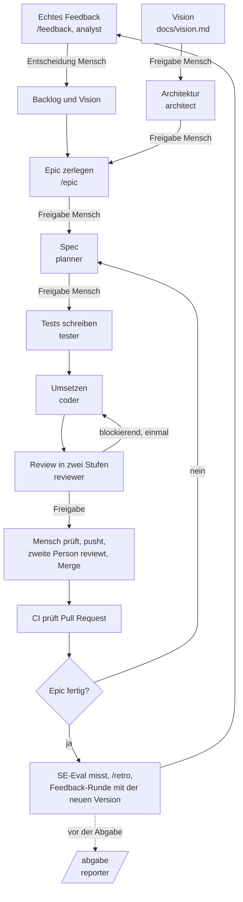

# SportMate – Projektmanagement

| | |
| --- | --- |
| Projekt | SportMate – Hochschul-Softwareprojekt, Wintersemester 2026/27 |
| Team | Julien, Renat, Paulo, Niklas |
| Hauptverantwortlich | Niklas (Rolle „Management und Qualitätssicherung“ laut Präsentation 1 vom 30.09.2026; vom Team zu bestätigen) |
| Autorinnen und Autoren mit Anteil in % | |
| Stand | Entwurf vom 23.11.2026, zusammengestellt von der Agentenrolle reporter |
| Repository | <https://github.com/Paulo-Temme/SportMate> (Branch `develop`) |
| Projekt-Board | **Link offen** – Einladung zum Board vom Team zu verschicken und hier einzutragen |
| Live-App | <https://sportmate-gamma.vercel.app> |

## Inhalt

1. Lebenszyklusmodell und Vorgehen
2. Rollen im Team
3. Arbeit mit KI-Agenten: Rollen, Freigabepunkte, was der Mensch entscheidet
4. Praktiken mit Nachweis im Repository
5. Werkzeuge
6. Zeitplan und Verlauf (P1–P7)
7. Was lief gut, was lief schlecht
8. Probleme und ihre Lösungen
9. Risiken
10. Statistik
11. Verbesserungsideen
12. Literatur
13. Lücken

Abkürzungen: **P1–P7** = Präsentationstermine des Kurses · **CI** = Continuous Integration, automatische Prüfung bei
jedem Pull Request · **PR** = Pull Request · **ADR** = Entscheidungsnotiz · **DoD** = Definition of Done ·
**TDD** = Test-Driven Development (Tests vor dem Code).

## 1. Lebenszyklusmodell und Vorgehen

### 1.1 Geplant (Präsentation 1, 30.09.2026)

- **Modell:** agil und iterativ, an Scrum angelehnt; zweiwöchige Iterationen mit Planung, Umsetzung, Review und Retrospektive.
- **Praktiken:** priorisierte User Stories, wöchentlicher Teamabgleich, Code-Reviews und automatisierte Tests bei jedem Push.
- **Begründung:** Bedarf und Buchungsablauf waren unsicher. Kurze Iterationen erlauben frühes Nutzerfeedback und passen
  zu den festen Präsentationsterminen.
- **Fertig bedeutet:** Akzeptanzkriterien erfüllt, Review abgeschlossen, Tests bestanden.

(Quelle: `SportMate_Praesentation_1.pptx`, Folie 6.)

### 1.2 Umgesetzt: iterativer, agentengestützter Prozess mit Freigabepunkten

Seit dem Aufsetzen des Repositorys (23.11.2026) arbeitet das Team nach dem in `docs/prozess.md` beschriebenen Ablauf:
Echtes Feedback und die Vision speisen das Backlog; je Epic werden Stories zerlegt; je Story entstehen Spec, Tests,
Code und Review in fester Reihenfolge durch KI-Agenten. Ein Mensch gibt an sechs Stellen frei und führt Push und Merge
selbst aus. Nach jedem Epic folgen Messung (SE-Eval), Retrospektive und eine Feedbackrunde mit der neuen Version.

Bezug zu Scrum/XP: Iterationen im Takt der Präsentationen, Backlog mit MoSCoW-Priorität, User Stories mit
Akzeptanzkriterien, TDD, CI, Retrospektive je Sprint (`docs/management/praktiken.md`). Ein Vergleich mit einer
alternativen Vorgehensweise ist im Repository noch nicht dokumentiert (siehe Lücken).

## 2. Rollen im Team

| Verantwortung | Person | Aufgaben laut Präsentation 1 (Folie 5) |
| --- | --- | --- |
| Anforderungen | Julien | Interviews, User Stories und Akzeptanzkriterien; Kundenfeedback dokumentieren |
| Architektur und Entwurf | Renat | Systemstruktur, Datenmodell und Oberflächenentwurf |
| Implementierung | Paulo | Entwicklung koordinieren, Code integrieren, Coding-Regeln pflegen |
| Management und Qualitätssicherung | Niklas | Planung, Board, Tests und Fortschrittsdokumentation |

„Alle entwickeln und reviewen. Die Rollen sichern Koordination und vollständige Ergebnisse.“ (Folie 5)
Die Tabelle „Rollen im Team“ in `docs/management/praktiken.md` (mit Vertretung) ist noch leer.

## 3. Arbeit mit KI-Agenten: Rollen, Freigabepunkte, was der Mensch entscheidet

### 3.1 Agentenrollen

| Rolle | Aufgabe | Schreibt nur in | Modell |
| --- | --- | --- | --- |
| Orchestrator (Hauptsitzung) | steuert Reihenfolge, prüft Ergebnisse, hält an Freigabepunkten | `docs/backlog.md`, `docs/learnings.md`, `docs/tech-debt.md`, `docs/management/` | Standard der Sitzung |
| analyst | echtes Feedback auswerten, Konsequenzen vorschlagen | `docs/feedback.md`, `docs/feedback/` | stark |
| architect | Architekturtreiber, Stil, Bausteine, Detailentwurf, Datenmodell | `docs/architecture.md`, `docs/decisions/` | stark |
| planner | Story in prüfbare Spec übersetzen | `specs/` | stark |
| tester | fehlschlagende Tests aus der Spec | Testdateien, `specs/` | mittel |
| coder | Tests grün machen | alles außer Testdateien, Spec und Review | mittel |
| reviewer | gegen Spec, Architektur und Regeln prüfen | `specs/F-XX/review.md`, `log.md` | stark |
| reporter | Abgabedokumente zusammenstellen | `abgabe/` | mittel |

Die Spalte „Schreibt nur in“ setzt der Schutz-Hook `.claude/hooks/guard.mjs` durch. Er lehnt außerdem für alle Agenten
`git push`, `git pull`, `git merge`, Commits auf `main`, `--no-verify` und `.env`-Dateien ab. Grenze: Der Hook prüft
Schreibwerkzeuge und git-Befehle; er ersetzt nicht das Lesen des Diffs durch den Menschen (`docs/prozess.md`).

Weitere Regeln für Agenten (`CLAUDE.md`): Der Orchestrator schreibt selbst keinen Anwendungscode, prüft nach jedem
Schritt das Ergebnis (Datei vorhanden, `make check`, Protokolleintrag), hält an Freigabepunkten an und stoppt nach drei
gescheiterten Versuchen. „Fertig“ heißt: Der Prüfbefehl ist gelaufen und seine Ausgabe wird genannt. Nichts erfinden:
kein Feedback, keine Personen, keine Messwerte, keine Literatur.

### 3.2 Freigabepunkte des Menschen

1. Vision
2. Konsequenz aus jedem Feedback
3. Architektur (beim Start und wenn ein Epic sie ändert)
4. Liste der Stories eines Epics
5. Spec jeder Story
6. Push und Merge jeder Story, nach eigenem Ausprobieren der App und Review durch eine zweite Person

Zusätzlich liest ein Mensch Code zu Login, Rechten, Zahlungen und Datenbankschema selbst; Agenten markieren solche
Stellen im Protokoll („Besondere Vorsicht“, z. B. `specs/F-01/log.md`).

### 3.3 Befehle

| Befehl | Wann | Ergebnis |
| --- | --- | --- |
| `/start` | einmal pro Projekt | Vision und Architektur |
| `/feedback <Rohmaterial>` | nach jedem Gespräch, Nutzertest, jeder Umfrage | Einträge im Feedback-Register, entschiedene Konsequenzen |
| `/epic <Beschreibung>` | pro Epic | Stories im Backlog mit Quelle, Architektur geprüft |
| `/feature F-XX` | pro Story | Spec, Tests, Code, Review auf einem Branch |
| `/status` | jederzeit | Stand von Backlog, Branch, laufender Story, Feedback |
| `/retro <Sprint>` | je Sprint | Retrospektive mit Fakten aus dem Repo und Antworten des Teams |
| `/abgabe [Bereich]` | vor Präsentationen und vor der Abgabe | Entwürfe der Abgabedokumente mit Liste der Lücken |

### 3.4 Stand der Freigaben (23.11.2026)

Vision, Architektur, ADRs, Backlog und Specs tragen „Freigabe offen“; alle Feedback-Konsequenzen haben den Status
„Vorschlag“. Das menschliche Review der Migration und der Anmelde-/Datenzugriffsdateien steht laut Review-Protokoll aus.

## 4. Praktiken mit Nachweis im Repository

| Praktik | Woher | Warum hier | Nachweis im Repo | Quelle |
| --- | --- | --- | --- | --- |
| User Stories mit Akzeptanzkriterien | XP, Scrum | Anforderungen aus Nutzersicht, klein genug für einen Tag | `docs/backlog.md`, `specs/F-XX/spec.md` | Cohn (2004): User Stories Applied |
| Test-Driven Development | XP | Anforderung wird vor der Lösung prüfbar; schützt vor Code, den niemand verlangt hat | getrennte Commits Tests → Code, `make trace` | Beck (2002): Test-Driven Development |
| Kleine Schritte, ein Branch je Story, Pull Request | Trunk-nahe Entwicklung | Prüfbare Änderungen, `main` bleibt lauffähig | Branch-Namen, Pull Requests | Quelle offen |
| Continuous Integration | XP, DevOps | Fehler fallen am Pull Request auf, nicht bei der Abgabe | `.github/workflows/ci.yml`, CI-Läufe | Quelle offen |
| Reviews in zwei Stufen | Inspektion | Zweites Augenpaar findet, was Tests nicht finden | `specs/F-XX/review.md`, Reviews im Pull Request | Fagan (1976): Design and code inspections |
| Entscheidungsnotizen | Architecture Decision Records | Begründungen bleiben auffindbar | `docs/decisions/` | Nygard (2011): Documenting Architecture Decisions |
| Kontinuierliches Kundenfeedback | Startup-Sicht des Kurses | Annahmen werden an echten Personen geprüft | `docs/feedback.md`, Quelle je Story | Quelle offen |
| Retrospektive je Sprint | Scrum | Prozess wird regelmäßig angepasst | `docs/management/retros/` | Quelle offen |
| Entwicklung mit KI-Agenten in festen Rollen und Freigabepunkten | eigene Wahl | Wiederholbarer Ablauf; der Mensch entscheidet an fünf Stellen | `.claude/`, `specs/F-XX/log.md` | Quelle offen |
| Messung mit SE-Eval | eigene Wahl | Qualität über die Zeit sichtbar, unabhängig von der eigenen Konfiguration | Berichte je Epic | – |

Beobachtbare Einhaltung (geprüft am 23.11.2026):

- **Feature-ID in jeder Commit-Nachricht:** 55 von 56 Commits bis zum Endlauf-Commit `004a9fa` beginnen mit `F-xx:`; Ausnahme ist der „Initial commit“.
- **Tests vor Code, getrennt committet:** z. B. `5b05ecf` (Tests Kernlogik) vor `1c5de92` (Kernlogik), `d93e8de`
  (Akzeptanztests F-22) vor `90cf99b` (Umsetzung F-22), `787d9f8` vor `08cd177` (F-06).
- **CI:** `.github/workflows/ci.yml` mit `make trace`, `setup`, `lint`, `typecheck`, `coverage`, `build` bei jedem PR und
  Push auf `main`/`develop`.
- **Entscheidungsnotizen:** 10 ADRs in `docs/decisions/`.
- **Protokolle der Agenten:** `specs/F-00`, `F-01`, `F-05`, `F-06`, `F-07`, `F-08`, `F-12`, `F-13`, `F-17`, `F-18`, `F-22`, `F-23`, `F-24`, `F-32` (`log.md`).
- **Ausnahme Tests vor Code:** `ded1894` (BUG-04) enthält Test und Umsetzung in einem Commit.
- **Nicht eingehalten bzw. nicht belegt:** ein Branch und PR je Story (alle 55 Agenten-Commits liegen direkt auf `develop`,
  Branches im Repository nur `main` und `develop`); Retrospektiven (nur Vorlage); Zeiterfassung (leer).

## 5. Werkzeuge

| Zweck | Geplant (Präsentation 1, Folie 7) | Eingesetzt (Nachweis) |
| --- | --- | --- |
| Anforderungen | GitHub Issues | Markdown im Repo: `docs/vision.md`, `docs/backlog.md`, `docs/feedback.md`, `specs/` |
| Entwurf | Claude Design o. ä. (Klickprototyp), diagrams.net | Mermaid-Diagramme in `docs/architecture.md`; Designleitlinien `docs/design.md` |
| Implementierung | VS Code, Git/GitHub, Codex und Claude Code; TypeScript, React, Supabase | Git/GitHub, Claude Code mit Agentenrollen (`.claude/`), Next.js/React/TypeScript, Supabase |
| Test | Vitest, Playwright | Vitest, Testing Library, Playwright; SE-Eval |
| Management | GitHub Projects und Actions; Markdown für Doku und Aufwand | GitHub Actions (CI); Board: Link offen; Zeiterfassung `docs/management/zeiterfassung.csv` (leer); Statistik `scripts/stats.mjs` |
| Hosting | – | Vercel (<https://sportmate-gamma.vercel.app>), Supabase |

## 6. Zeitplan und Verlauf (P1–P7)

| Termin | Thema / Stand | Ergebnis (Quelle) |
| --- | --- | --- |
| P1, 30.09.2026 | Idee, Hypothesen, Rollen, Lebenszyklus, Werkzeuge | `SportMate_Praesentation_1.pptx` |
| bis 14.10.2026 | Erhebung: Interviews (10./11.10.), Umfrage (11.10.) | FB-01 – FB-42 (`docs/feedback.md`) |
| P2, 14.10.2026 (Datum laut Foliensatz) | Anforderungen und Erhebungsergebnisse | Präsentation 2; `SportMate – Anforderungen.docx` |
| P3, 28.10.2026 | Architektur und Prototyp (Leaflet-Karte, Fachlogik, 9 ADRs, 81 Altanforderungen) | Ordner „P3 Neu“, Stand 27.10.2026 |
| bis 27.10.2026 | Feedbackrunde mit 4 Personen zur MVP-Demo | FB-43 – FB-58 |
| P4, Datum offen | Projektfortschritt seit P3: Architektur und Implementierung, Coding-Standards | `P4.pptx` |
| 10.11.2026 | Repository angelegt („Initial commit“) | `git log` |
| 23.11.2026 | Agentenvorlage übernommen, Next.js-Grundgerüst, Datenschicht, Release-1-Oberfläche, Tests, Testdokumentation, Präsentation 5, Behebung aller 4 Fehler und von 10 Review-Befunden, Endlauf (55 Commits bis `004a9fa`) | `git log`, `docs/testing/testbericht.md` |
| P5, 25.11.2026 | Qualität und Tests | Release 1 auf Vercel |
| P6, Termin offen | geplant: Nutzertest mit 5 Personen (NFR-1) | offen |
| P7, Termin offen | Abschluss und Reflexion | offen |

Sprints/Iterationen mit geplantem und erreichtem Umfang sind im Repository nicht dokumentiert (keine Retros, Board-Link
fehlt). Für Release 1 waren 14 Stories geplant (`docs/backlog.md`); Akzeptanztests liegen für alle 14 vor, zusätzlich
für Teile von F-09, F-14, F-15, F-25 und F-31 (siehe Dokument „Anforderungen“, Abschnitt 7.2).

## 7. Was lief gut, was lief schlecht

`docs/management/retros/` enthält nur die Vorlage; es gibt keine durchgeführte Retrospektive. Eine Bewertung des Teams
wird hier deshalb nicht wiedergegeben (Regel der Rolle reporter). Siehe Lücken.

## 8. Probleme und ihre Lösungen

`docs/management/probleme.md` ist noch leer. Die folgenden Probleme sind in anderen Projektdokumenten belegt:

| Datum | Problem | Auswirkung | Lösung | Status | Quelle |
| --- | --- | --- | --- | --- | --- |
| 23.11.2026 | Supabase-Modus lud keine Treffen (PostgREST `PGRST201`, mehrdeutige Einbettung) | Kernablauf im Supabase-Modus nicht nutzbar | Beziehung im Abfragecode ausdrücklich benannt | behoben | BUG-01, Commit `67a90f1` |
| 23.11.2026 | Integrationstests hinterließen sichtbare Testtreffen in der echten Datenbank | Testdaten für alle Nutzenden sichtbar | Altdaten gelöscht; Test sagt jedes Treffen in `afterEach` ab, Titel mit „[Test]“ | behoben, live geprüft (4/4 Testtreffen abgesagt) | BUG-03, REV-03, Commit `d5d8a62` |
| 23.11.2026 | Toast „Du bist angemeldet“ nach Beitritt klang nach Login | Missverständnis | erst Akzeptanztests umgestellt, dann Text „Du bist dabei“ | behoben, Akzeptanztests grün im Endlauf | BUG-02, Commits `49eb701`, `6b9a4d9` |
| 23.11.2026 | Playwright startete nicht, weil parallel ein zweiter Dev-Server lief (Next.js 16 erlaubt einen je Ordner) | kein Testergebnis im Projektordner | Lauf auf sauberer Kopie des Commits (`git archive`, `npm ci`) | umgangen | `docs/testing/testbericht.md` |
| 23.11.2026 | Mutation Score 7,69 % trotz 100 % Zeilen-Coverage der Kernlogik | Kennzahl nicht verwertbar | als Messfehler unter Windows eingestuft, Wiederholung unter Linux offen | offen | `docs/teststrategie.md` Abschnitt 8 |
| 23.11.2026 | Treffen > 12 h: lokal angenommen, im Supabase-Modus falsche Meldung | unterschiedliches Verhalten der Modi | 12-h-Regel in der Kernlogik mit eigener Meldung | behoben, Unit-Tests grün | BUG-04, REV-01, Commit `ded1894` |
| 23.11.2026 | Beim Endlauf fehlten die Playwright-Browser auf dem Rechner (118 Abbrüche vor dem ersten Test) | kein E2E-Ergebnis | `npx playwright install chromium`, danach 117 bestanden, 1 gewollt übersprungen | gelöst | `docs/testing/testbericht.md` |
| 23.11.2026 | Playwright brauchte einen neueren Chromium-Build | E2E im Setup nicht lauffähig | Mensch führt `npx playwright install chromium` aus | gelöst | `specs/F-00/log.md` |
| P2/P3 → 23.11.2026 | Interviews waren in den Originaldateien als KI-Simulation vermerkt; Team stuft sie als reale Gespräche ein | Belastbarkeit der Erhebung unklar | Teamentscheidung dokumentiert, alte IDs SIM-01…04 durch INT-01…04 ersetzt | dokumentiert, Belege offen | `docs/feedback.md` |
| 23.11.2026 | Regel „höchstens 12 Stunden“ nur in SQL | Modi verhalten sich verschieden, falsche Meldung | Test und Regel in der Kernlogik geplant | offen | BUG-04, REV-01 |

## 9. Risiken

| Risiko | Folge | Gegenmaßnahme | Quelle |
| --- | --- | --- | --- |
| Kein automatischer Paralleltest auf den letzten Platz | Überbuchungsschutz nur durch Entwurf und Review belegt | Zeilensperre + Check-Constraint; manueller `psql`-Test beschrieben | ADR-0006, `supabase/README.md` |
| Doppelte Regeln in TypeScript und SQL | Modi verhalten sich verschieden (BUG-04) | Vertragstests, gleiche Grenzwerte | `docs/architecture.md`, Risiken |
| OpenFreeMap ohne Verfügbarkeitszusage | Karte fällt aus | Offline-Karte als Pflicht-Rückfall, Liste immer gleich | ADR-0004 |
| Supabase-Free-Tarif pausiert inaktive Projekte | Live-App ohne Daten | vor Präsentationen prüfen, Seed neu ausführen | ADR-0002, `docs/architecture.md` |
| Wenige reale Befragte, kein Nutzertest | Anforderungen nicht validiert (H-2, H-5) | Nutzertest P6, Rekrutierung offen | `docs/vision.md`, FB-11 |
| Kritische Masse: leere Plattform | Gruppen bleiben bei WhatsApp (FB-21) | Link teilen (F-15), Seed-Treffen für Demo | `docs/vision.md` H-5 |
| Code-Review nur durch Agenten | Sicherheitsfehler in Auth/RLS unentdeckt | menschliches Review der markierten Dateien (Freigabepunkt 6) | `docs/testing/review-protokoll.md` |
| Arbeit konzentriert auf ein Git-Konto und einen Tag | Beiträge der Teammitglieder aus `git log` nicht ablesbar, Risiko für Bewertung „stetiger Fortschritt“ | Zeiterfassung und Board nachpflegen, künftig Commits/PRs je Person | Statistik unten |

## 10. Statistik

Gezählt am 23.11.2026 aus `git log` des Branches `develop`, Stand Endlauf-Commit `004a9fa` (56 Commits). Danach folgten nur
Dokumentations-Commits (Testberichte, Backlog, Architektur, Präsentation, Abgabe). `make stats` (`docs/management/statistik.md`)
wurde nicht ausgeführt; die Zahlen unten stammen direkt aus `git log`. SE-Eval zählt für denselben Stand 55 Commits ohne Merges
(ohne „Initial commit“ im Sprint), Commit-Größe Median 121 Zeilen, P90 1.028 Zeilen, 100 % mit KI-Co-Autor.

### 10.1 Commits je Person und Woche

| Git-Konto | Person (laut Git-Konto) | KW 46 (10.11.2026) | KW 48 (23.11.2026) | Summe |
| --- | --- | ---: | ---: | ---: |
| `Paulo-Temme` | Paulo | 1 | 0 | 1 |
| `nife1060` | Niklas | 0 | 55 | 55 |
| Julien, Renat | – | 0 | 0 | 0 |

Alle 55 Commits von `nife1060` stammen vom 23.11.2026 und wurden im Agentenprozess erzeugt. Die Commits zeigen daher,
**über welches Konto** eingecheckt wurde, nicht, wer wie viel beigetragen hat. Arbeit vor dem 23.11.2026 (Erhebung,
Präsentationen P1–P4, Prototyp aus P3) liegt außerhalb dieses Repositorys.

### 10.2 Commits je Story

| Feature-ID | F-00 | F-01 | F-02 | F-05 | F-06 | F-08 | F-12 | F-13 | F-17 | F-18 | F-22 | F-24 | F-32 |
| --- | ---: | ---: | ---: | ---: | ---: | ---: | ---: | ---: | ---: | ---: | ---: | ---: | ---: |
| Commits | 9 | 5 | 1 | 10 | 2 | 5 | 4 | 1 | 3 | 1 | 10 | 1 | 3 |

### 10.3 Codezuwachs

| | hinzugefügt | entfernt |
| --- | ---: | ---: |
| alle Textdateien (Binärdateien nicht gezählt) | 31.497 | 808 |
| ohne `package-lock.json` | 23.161 | 808 |

Stand Commit `004a9fa`: 299 versionierte Dateien, davon 146 unter `src/`; 8.012 Zeilen in `src/**/*.ts(x)` (einschließlich Tests).
SE-Eval misst 4.990 Codezeilen App (SLOC, ohne Tests) und 34,13 % Anteil Testcode.

### 10.4 Hauptbeitragende je Datei

Bis auf die ursprüngliche `README.md` (Initial commit von `Paulo-Temme`) wurden alle versionierten Dateien über das
Konto `nife1060` angelegt.

### 10.5 Aufwand je Person und Tätigkeit

**Offen.** `docs/management/zeiterfassung.csv` enthält nur die Kopfzeile (Format: `datum;person;stunden;feature;taetigkeit`,
Tätigkeiten Anforderungen | Architektur | Implementierung | QA | Management). Es liegen keine echten Zeitdaten vor.

## 11. Verbesserungsideen

Im Repository sind keine Verbesserungsideen des Teams aus Retrospektiven dokumentiert. Aus den Prüfdokumenten
vorgeschlagene Maßnahmen (keine Teambewertung): Supabase-Integrationstests vor jedem Merge mit Datenzugriffsänderungen
ausführen (REV-02, offen), Supabase-Integration in die CI holen, Mutation Testing unter
Linux/CI wiederholen (`docs/teststrategie.md`), Komplexitätsregel per ESLint-Plugin prüfen (REV-14).

## 12. Literatur

Quellen, die in den Projektdokumenten genannt werden (vom Team vor der Abgabe zu prüfen, `docs/coding-standards.md`):

- Bass, L.; Clements, P.; Kazman, R. (2012): Software Architecture in Practice. 3. Auflage. Addison-Wesley. – Qualitätsmerkmale als Architekturtreiber.
- Beck, K. (2002): Test-Driven Development: By Example. Addison-Wesley. – TDD.
- Campbell, G. A. (2018): Cognitive Complexity. A new way of measuring understandability. SonarSource. – Komplexitätsgrenze 15.
- Cohn, M. (2004): User Stories Applied. Addison-Wesley. – User Stories mit Akzeptanzkriterien.
- Fagan, M. E. (1976): Design and code inspections to reduce errors in program development. IBM Systems Journal 15(3). – Reviews.
- Fowler, M. (2002): Patterns of Enterprise Application Architecture. Addison-Wesley. – Repository-Muster (ADR-0003).
- Fowler, M. (2015): MonolithFirst. Blogbeitrag. – ADR-0001.
- Martin, R. C. (2008): Clean Code. Prentice Hall. – Namensregeln.
- Nygard, M. (2011): Documenting Architecture Decisions. Blogbeitrag. – Format der ADRs.
- Parnas, D. L. (1972): On the criteria to be used in decomposing systems into modules. Communications of the ACM 15(12). – Information Hiding.
- PostgreSQL-Dokumentation, Kapitel „Explicit Locking“. – Zeilensperre (ADR-0006).

Quelle offen laut `docs/management/praktiken.md`: kleine Schritte/Branch je Story, Continuous Integration, kontinuierliches
Kundenfeedback, Retrospektive, Entwicklung mit KI-Agenten. ISTQB-Lehrplan ohne Version und Seite (`docs/teststrategie.md`).

## 13. Lücken

Siehe auch `abgabe/LUECKEN.md`.

| Bewertungskriterium | Was fehlt | Was das Team nachliefern muss |
| --- | --- | --- |
| Werkzeuge | Link und Einladung zum Projekt-Board | Board-Link eintragen, Einladung an die Lehrenden verschicken |
| Statistik: Aufwand | Zeiterfassung leer | echte Stunden je Person und Tätigkeit nachtragen (nur tatsächliche Werte), danach `make stats` |
| Stetiger Fortschritt | Commits nur an zwei Tagen, fast alle über ein Konto; Sprints nicht dokumentiert | Sprints/Iterationen mit geplant/erreicht (z. B. aus dem Board) beschreiben; Beiträge je Person erläutern |
| Reflexion | keine Retrospektive in `docs/management/retros/`; `probleme.md` leer | Retros zu den bisherigen Iterationen und P7-Reflexion schreiben (`/retro`) |
| Begründetes Modell | Vergleich mit mindestens einer Alternative fehlt; Rollen-Tabelle mit Vertretung leer | in `docs/management/praktiken.md` ergänzen |
| Praktiken sichtbar eingehalten | kein Branch/PR je Story nachweisbar | erklären oder künftig einhalten |
| Literatur | mehrere „Quelle offen“ | Quellen ergänzen und prüfen |
| Termine | Datum P4, P6, P7 | aus dem Kursplan eintragen |
